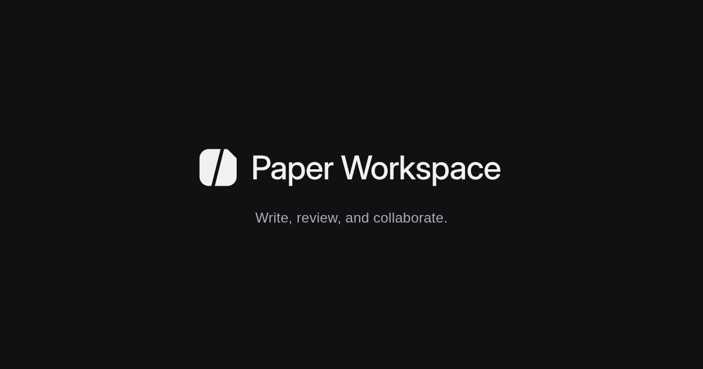
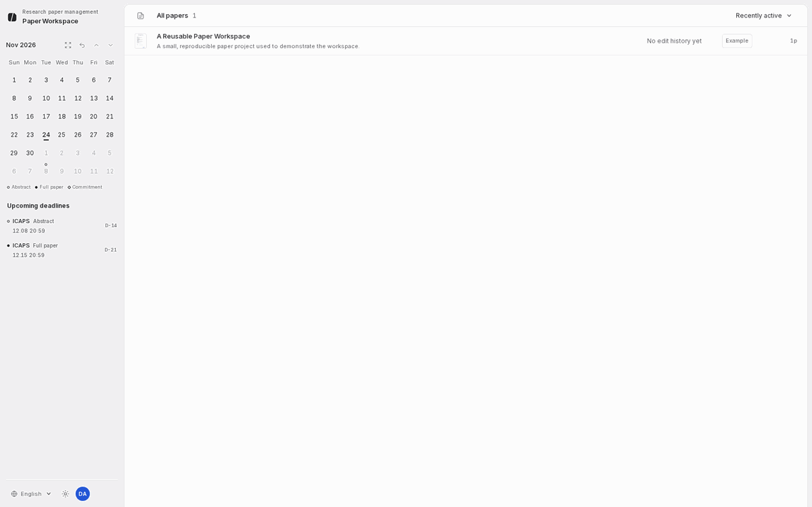

[English](README.md) | **한국어**

<div align="center">

# Paper Workspace

### LaTeX 논문을 함께 쓰고, 검토하고, 제출하세요.

원고와 PDF, 공동 작업자, 리뷰, 선택형 Codex 수정 도우미를<br />
하나의 집중된 화면에 모은 self-hosted 논문 작업공간입니다.

[빠른 시작](#빠른-시작) · [주요 기능](#논문의-전-과정을-하나의-작업공간에서) · [리버탈 스튜디오](#리버탈-스튜디오) · [아키텍처](docs/paper-platform/architecture.md) · [운영 절차](docs/paper-platform/operations.md) · [English](README.md)




<em>원고와 렌더링된 논문, 연구 대화를 언제나 같은 상태로.</em>

</div>

<br />

<div align="center">
  
</div>

이 데모는 공개 Example Paper를 실제로 LaTeX 컴파일해 촬영했습니다. 비공개 원고·심사 자료·서버 주소·인증 정보는 포함하지 않았습니다.

## 논문의 전 과정을 하나의 작업공간에서

| **작성** | **협업** | **안전한 제출** |
| --- | --- | --- |
| LaTeX와 렌더링 PDF를 나란히 보고 SyncTeX로 이동하며, 원고를 떠나지 않고 모든 소스와 그림을 관리합니다. | 변경을 실시간으로 병합하고 댓글과 작업을 문장에 연결하며, 반복적인 Codex 제안을 검토한 뒤 적용합니다. | 제출 위험을 검사하고 재현 가능한 원고를 패키징하며, 버전을 비교하고 자동·이름 있는 백업에서 복구합니다. |

<details>
<summary><strong>전체 기능 보기</strong> — 프로젝트, 작성, PDF, 협업, Codex, 제출, 복구와 접근성</summary>

<br />

### 프로젝트와 파일

- 프로젝트 허브에서 여러 논문을 고정 URL로 관리하고, 첫 페이지 PDF 썸네일, 마지막 수정자와 수정 시각을 담은 간결한 활동 요약, 최근 활동순 정렬을 사용합니다. 성공한 원고 빌드에서 페이지 수를 자동으로 갱신합니다.
- 학회 마감 캘린더의 월간 보기에서 한국 표준시 기준 예정 마감과 공식 일정 링크를 확인합니다.
- 허브에서 대상 학회와 프로젝트 설명을 편집합니다. 저장 시 리비전을 확인해 동시 수정 내용을 덮어쓰지 않으며, 충돌하면 입력한 초안을 유지합니다.
- 전체 경로로 프로젝트 트리를 검색하며, 보관용 `drafts`는 사용자의 이후 선택을 덮어쓰지 않고 처음에만 접힙니다.
- 파일과 폴더를 생성·이름 변경·이동·삭제하고, 개별 파일이나 전체 폴더 트리를 드래그해 가져옵니다.
- 텍스트와 binary asset을 한 브라우저에 가두지 않고 프로젝트 구성원과 공유합니다.
- 이미지와 여러 페이지 PDF를 확대·축소하며 미리 보고, 외부 앱이 필요한 asset은 다운로드합니다.
- 독립 `.tex` 문서는 직접 열고, fragment는 메인 원고 preamble을 재사용해 미리 봅니다.

### LaTeX 작성

- CodeMirror 구문 강조, 괄호 인식 편집, 자동완성, 검색, 선택과 줄 번호를 사용합니다.
- 서버를 기다리지 않고 파일별 undo/redo, `Cmd/Ctrl+S`, 커서 위치를 보존하는 편집 이력을 사용합니다.
- 변경을 자동 저장하고 원고 입력이 잠시 멈추면 새 PDF 빌드를 시작합니다.
- 긴 원문 줄이나 요청 문장을 가로로 억지로 압축하지 않고 큰 프로젝트를 검색합니다.
- 브라우저 초안과 배포된 서버 원문을 구분하고 서버 변경을 감지해 보존한 초안을 필요할 때 엽니다.
- 손상되었거나 용량 제한에 걸린 브라우저 상태도 원고 로딩을 막지 않도록 복구합니다.

### PDF 미리보기와 SyncTeX

- 격리된 TeX Live 서비스에서 컴파일하고 cache 상태와 바로 조치할 수 있는 오류를 표시합니다.
- 긴 PDF를 필요한 페이지부터 렌더링하고 포인터 아래를 확대하며 현재/전체 페이지 표시를 유지합니다.
- 새 PDF 렌더가 이전 결과를 교체해도 보고 있던 페이지와 스크롤 위치를 보존합니다.
- PDF를 클릭해 LaTeX 원문으로 이동하고, 원문을 `Cmd/Ctrl+click`해 해당 PDF 위치를 찾습니다.
- PDF에서 원문으로 이동할 때 줄바꿈된 원문 줄 전체를 정확히 강조합니다.
- 컴파일이 실패해도 마지막 정상 PDF를 유지하고 정리된 오류에서 가장 적합한 원문 줄로 바로 이동합니다.
- 기본 원고 entrypoint를 명확히 유지하면서 독립 문서와 fragment를 미리 봅니다.

### 실시간 공동편집과 리뷰

- Yjs로 동시 텍스트 변경을 병합하고 공동 작업자의 이름·색상·커서·현재 파일 위치를 표시합니다.
- 처음 입장할 때 이름이나 닉네임을 입력합니다. 기본 이름인 `나`·`Me`는 변경해야 하며, 설정한 이름은 같은 브라우저의 모든 논문에서 기억하고 이름을 정한 뒤에만 접속자로 표시합니다.
- 연결이 끊겨도 로컬 편집을 계속하고, 재연결 후 대기 중인 변경을 병합한 다음에만 공유 완료로 표시합니다.
- 선택한 문장과 revision에 댓글을 연결하고 인라인 표시에서 맥락으로 돌아가며 완료된 대화를 해결 처리합니다.
- 선택 영역을 완료 상태·담당 맥락·파일 위치·원문 바로가기가 포함된 공유 작업으로 만듭니다.
- 프로젝트 수준 마지막 수정자와 활동 시각을 기록해 최근 작업순에 서버 활동을 반영합니다. 공유 비밀번호 모드는 인증되지 않은 브라우저 표시 이름을, OAuth는 인증된 이메일을, 개인 계정 모드는 인증 프록시가 제공하는 계정 ID를 사용합니다.
- 작업공간 상태 센터에서 공동편집·저장·PDF·백업 최신 상태를 함께 확인합니다.

### Codex 수정 흐름

- 선택 문장, 요청, 현재 파일 맥락과 작업 목적별 모델 프로필을 선택형 Codex bridge로 보냅니다.
- Enter로 전송하고 Shift+Enter로 줄바꿈하며, 한국어 IME 조합 중에는 잘못 전송하지 않습니다.
- 이전 요청과 제안을 하나의 대화로 유지하고 현재 선택과 앞선 제안을 기억하는 후속 요청을 보냅니다.
- 웹을 새로고침하지 않고 명시적으로 새 대화를 시작합니다.
- 제안된 LaTeX, 설명과 변경 전후 diff를 검토한 다음 원문에 적용합니다.
- Codex가 작업하는 동안 선택 원문이 바뀌었다면 자동 적용을 거부합니다.
- 도우미를 접어도 대화를 보존하고, PDF 빌드나 컴파일 오류가 다른 영역에서 발생해도 작업을 유지합니다.

### 제출 검사와 연구 자료

- 최신 원고와 PDF를 기준으로 페이지 제한, 내장 폰트, 누락된 그림, 익명성 후보와 제출 위험을 검사합니다.
- 사용·미사용 Figure/Table을 분류하고 asset 결과에서 해당 원문 참조로 이동합니다.
- 프로젝트 전체에서 누락·중복·사용·미인용 참고문헌을 탐지합니다.
- citation key를 중복 추가하지 않으면서 BibTeX를 가져옵니다.
- 컴파일 오류가 발생한 파일과 줄을 바로 엽니다.
- 필요한 원문 파일, binary asset과 `SHA256SUMS`가 들어간 제출용 Source ZIP을 만듭니다.

### 버전·복구·작업공간 경험

- 10분 자동 서버 복구 지점, 이름 있는 checkpoint, 파일 비교와 한 번에 복원을 제공합니다.
- primary data, 프로젝트 asset과 압축 백업 export를 분리해 서로 다른 저장소를 연결할 수 있습니다.
- 원문·PDF·도우미 패널 폭을 조정하고 도우미 접기·폭 초기화·개인 레이아웃 저장을 사용합니다.
- 작은 화면에서는 Source·PDF·Assistant 집중 화면으로 전환하고 모바일 하단 탐색에서 Files를 엽니다.
- 라이트·다크·시스템 화면 모드를 선택하되 렌더링된 논문 페이지는 출판물 색상을 위해 흰색으로 유지합니다.
- 브라우저 감지, 명시적 선택 저장과 공유 가능한 `?lang=` 링크로 영어·한국어를 사용합니다.
- 키보드로 도우미 탭과 크기 조절기를 탐색하고, focus 표시·reduced motion·모바일 터치 크기를 지원합니다.
- 맥락이 중요한 곳에 지속 상태·인라인 피드백·토스트를 사용해 로딩·오프라인·대기·오래된 PDF·충돌·성공·오류 상태를 표시합니다.

</details>

기본 UI는 영어입니다. 저장된 선택이 없고 브라우저 언어가 한국어일 때만 한국어를 자동 선택하며, 우측 상단 선택값은 브라우저에 유지됩니다. `?lang=en` 또는 `?lang=ko`를 붙이면 언어가 고정된 링크를 공유할 수 있습니다.

## 리버탈 스튜디오

<p align="center">
  
  
  
  
  
  
  
  
  
  
</p>

**Reviewer Mates**는 리버탈 스튜디오에서 리뷰어를 구분하는 다채로운 아바타입니다. `REBUTTAL_ENABLED=true`로 활성화하고, 필요한 경우 쉼표로 구분한 `REBUTTAL_PROJECTS` 목록으로 대상을 제한하세요. `/p/<slug>/rebuttal`을 열거나 Paper 탭에서 전환할 수 있습니다. 두 화면은 프로젝트 세션과 실시간 접속 상태를 공유합니다. 전환 중에도 Paper 편집기는 열린 상태를 유지하며, 리버탈 화면에서는 리뷰와 답변을 나란히 봅니다.

1. **리뷰를 검토한 뒤 가져오기.** 논문 URL 또는 포럼 ID로 OpenReview 공개 v1/v2 REST나 인증된 공식 SDK를 사용하며, 지원되는 MFA도 처리합니다. 일반 텍스트를 붙여넣거나 TXT, Markdown, JSON, 텍스트 PDF를 올릴 수 있습니다. PDF에서 추출한 문장의 줄바꿈을 자동으로 정리하고, 인쇄된 OpenReview 페이지에서 리뷰어와 Official Review의 이름 있는 항목을 구분합니다. 적용 전에 리뷰어와 항목을 확인하거나 가져오기 대기 목록에서 나중에 이어갈 수 있습니다. 스캔 PDF는 텍스트를 직접 입력해야 합니다.
2. **쟁점을 답변에 연결하고 협업하기.** 리뷰를 구조화된 쟁점으로 나누고, 리뷰 원문의 구절을 하나 이상의 답변 구절에 연결합니다. 답변이 쟁점을 얼마나 다루는지 확인하고 추천 연결을 승인하거나 거절할 수 있습니다. 초안에 근거, 작업, 인라인 협업 메모와 답글 스레드를 남기고, 리뷰어별 답변과 선택적 공통 답변은 Yjs로 동기화합니다.
3. **영어·한국어로 작성하기.** 답변 옆에서 인라인 한국어 리뷰 번역을 읽고, 병렬로 관리되는 영어·한국어 답변 초안을 전환합니다. 증분 번역은 변경되지 않은 문단을 재사용하고 수동 편집을 보호합니다. 리뷰와 답변의 언어 선택은 프로젝트별로 따로 저장됩니다. 답변 언어를 바꿔도 편집기와 OpenReview 미리보기에서 읽던 위치가 유지됩니다. 실시간 미리보기는 Markdown과 MathJax SVG 수식을 렌더링하며 원문 위치와 동기화됩니다.
4. **분석하고 제출 조건 확인하기.** 샌드박스에서 실행되는 Codex Bridge를 통해 쟁점 추출, 답변 범위 분석, 어조·일관성 검사, 예상 질문, 문장 수정, 학회 규칙 조사와 검사를 요청합니다. 분석은 명시적으로 요청할 때 실행됩니다. 소유자와 편집자가 규칙 버전을 검토하고 적용합니다. 문서별, 조합된 제출본별, 전체 제출 기준의 제한을 실제 출력 텍스트로 검사합니다.
5. **제출본 확정·내보내기·복구하기.** 답변의 순서, 텍스트, 적용된 규칙을 제출본으로 고정합니다. 재현 가능한 PDF, ZIP, Markdown, JSON을 내보낼 수 있습니다. 동기화된 Yjs CRDT 답변과 메모 스레드를 포함해 라운드 전체를 백업·복원합니다. 복원 시 새 라운드와 답변 ID를 만들어 진행 중인 작업도 유지합니다.

OpenReview 자격증명은 일시적으로 처리하며, 토큰은 인증 세션에 묶여 서버 메모리에 보관됩니다. 내보내기와 백업은 초기화와 동기화가 완료된 답변을 사용합니다. [리버탈 사용·운영 절차](docs/paper-platform/rebuttal.md)와 [인터페이스 계약](docs/paper-platform/rebuttal-contract.md)을 참고하세요.

## 빠른 시작

Git, Docker Engine, Docker Compose v2가 필요합니다. 최초 TeX Live 빌드는 수 GB를 내려받을 수 있습니다.

```bash
cp infra/paper-workspace/.env.example infra/paper-workspace/.env
docker compose -f infra/paper-workspace/compose.yaml up --build -d
```

`https://localhost`를 엽니다. 로컬 Caddy 인증서를 신뢰하기 전에는 브라우저 경고가 표시될 수 있습니다.

```bash
docker compose -f infra/paper-workspace/compose.yaml ps
docker compose -f infra/paper-workspace/compose.yaml logs -f workspace compiler
docker compose -f infra/paper-workspace/compose.yaml down
```

## 여러 논문을 한 서버에서 관리

서버 루트에는 논문 목록이, 각 논문에는 slug 기반 고정 주소가 생깁니다.

```text
https://paper.example.com/
https://paper.example.com/p/aaai27
https://paper.example.com/p/forecasting
```

`PAPER_PROJECTS_DIR` 아래에 slug별 폴더를 만들고 루트 `index.json`에 카드를 등록합니다.

```json
{
  "projects": [
    {"slug":"aaai27", "display_name":"AAAI-27 Paper", "description":"Main submission"},
    {"slug":"forecasting", "display_name":"Forecasting Study", "description":"Time-series experiments"}
  ]
}
```

slug에는 영문·숫자·`-`·`_`만 사용하세요. 제목을 바꿔도 주소는 유지됩니다. 단일 논문은 `PAPER_PROJECT_DIR`, 목록 허브는 `PAPER_PROJECTS_DIR`를 사용합니다.

## 내 논문 연결

1. 예제 프로젝트를 이 저장소 밖의 새 폴더로 복사합니다.
2. `main.tex`, bibliography, 학회 `.cls`/`.sty`/`.bst`, 그림을 넣습니다.
3. 컴파일 입력을 `project.json`에 등록합니다.
4. `PAPER_PROJECT_DIR`을 연결하거나 `PAPER_PROJECTS_DIR` 아래에 배치한 뒤 Compose를 재시작합니다.

```json
{
  "entrypoint": "main.tex",
  "preview_entrypoints": ["main.tex", "supplement.tex"],
  "auto_include_roots": ["Figures", "generated"],
  "page_limit": 7,
  "files": [
    {"path":"main.tex", "type":"text"},
    {"path":"Figures/plot.pdf", "type":"asset"}
  ]
}
```

경로는 상대 경로여야 하며 `..`를 사용할 수 없습니다. 선택한 `.tex`가 독립 문서이면 직접 컴파일하고, appendix 같은 fragment이면 메인 preamble을 재사용합니다. 컴파일은 고정 파일 개수 대신 64 MB 작업공간 예산으로 제한합니다. 요청 크기에 파일과 서로 다른 폴더마다 4 KiB를 더해 계산합니다. 요청 48 MB, binary asset 합계 32 MB, 실행 시간 제한은 유지하며 브라우저 업로드는 파일당 8 MB입니다. 동적으로 만든 경로를 포함해 TeX가 전달된 모든 입력 파일을 사용할 수 있습니다.

`auto_include_roots`는 선택 설정입니다. 명시적으로 허용한 폴더 안에서 `\input`, `\include`, `\includegraphics`가 실제로 참조하는 기존 파일만 런타임에 자동 스테이징하며, 중첩된 TeX 입력도 따라갑니다. 참조하지 않은 파일, 브라우저에만 있는 누락 업로드, 숨김 경로와 심볼릭 링크는 계속 제외합니다.

일반 편집 빌드는 수명이 짧은 불투명 서버 토큰을 통해 컴파일러가 생성한 참조 보조 파일만 재사용하므로, 보통의 본문 수정은 LaTeX 한 번으로 끝납니다. 인용·라벨·참고문헌이 바뀌면 필요한 안정화 패스를 자동으로 추가합니다. **Source ZIP 만들기**는 패키징 전에 항상 깨끗한 다중 패스 컴파일을 수행합니다.

매니페스트에 등록한 서버 파일은 10초마다 원자적으로 스테이징됩니다. 열린 작업공간은 새 리비전을 감지하고 entrypoint 또는 `managed: true` 텍스트를 협업 서버를 통해 자동 반영합니다. 연결된 웹에서 이 관리 텍스트를 수정하면 짧은 지연 뒤 설정된 프로젝트 원본에도 원자적으로 역반영되므로, 로컬 도구와 이후 Codex 작업도 같은 최신 원고에서 시작합니다. 역반영은 서버가 보관한 기준 해시와 실제 파일이 일치할 때만 수행합니다. 협업 서버는 최근 공통 원본을 제한된 비공개 이력으로 보존하고, 웹과 로컬이 함께 바뀌면 3-way 병합합니다. 서로 다른 줄의 변경을 먼저 합치고, 같은 줄에서도 서로 떨어진 단일 문자 범위라면 제한된 보조 병합을 한 번 수행합니다. 실제 변경 영역이 겹치면 최신 로컬·서버 원본을 활성 원고로 반영하고, 충돌한 웹 편집본은 검토할 수 있도록 `paper/drafts/web-conflict-*`에 보존합니다. 편집기에는 공동 편집 전송과 실제 원본 파일 반영 완료가 구분되어 표시됩니다. 스테이징된 중간 리비전이 늦게 도착해도 더 최신인 웹 역반영본으로 되돌리지 않습니다. 오프라인 편집은 Yjs/IndexedDB에 남았다가 재연결·병합된 뒤 원본에 반영됩니다.

매니페스트 항목이 이미 삭제된 파일을 가리키면 런타임 스테이징은 해당 항목만 제외하고 `runtime_warnings`에 기록한 뒤 나머지 최신 원본 배포를 계속합니다. 실제로 참조 중인 파일이 없다면 LaTeX 컴파일은 기존처럼 누락 파일 오류를 표시하지만, 그 오류 때문에 관련 없는 모든 원본이 마지막 정상 런타임 리비전에 멈추지는 않습니다.

서버 원본을 절대 기준으로 유지할 관리 파일에는 `"locked": true`를 지정할 수 있습니다. 편집기는 해당 파일을 읽기 전용으로 표시하고, 협업 서버는 오래된 클라이언트의 쓰기를 거부한 뒤 디스크 원본으로 복구합니다. 잠금을 켜는 순간 발견한 다른 웹 내용은 `paper/drafts/locked-web-edit-*`에 보존합니다. 애플리케이션 잠금은 로컬 셸 프로세스까지 차단하지 않으므로, 특정 프로젝트에서 그것도 필요하면 운영체제 immutable 속성을 함께 사용해야 합니다.

`version`은 명시적인 seed/마이그레이션 호환성에 사용하세요. 이름을 바꾸거나 폐기한 서버 관리 텍스트 파일을 기존 공동 작업공간에서도 제거하려면 이전 상대 경로를 `retired_paths`에 적습니다. `files` 목록에서 빠졌다는 이유만으로 공동 작업 내용이 삭제되지는 않습니다.

## 일상 작업

- 편집 후 자동 저장과 PDF 갱신
- `Cmd/Ctrl+S`, `Cmd/Ctrl+Z`, `Cmd/Ctrl+Shift+Z`
- PDF 클릭으로 원본 이동, 원본에서 `Cmd/Ctrl+클릭`으로 PDF 이동
- 편집기 또는 PDF 위에서 `Cmd/Ctrl+휠` 확대·축소
- 선택 문장에 댓글·할 일·Codex 수정 요청 추가
- 프로젝트 트리에 파일·폴더 드래그, 그림 미리보기
- **검사**에서 인용·익명성 후보·누락 그림·페이지 수·글꼴 확인
- **Source ZIP 만들기**로 컴파일 가능한 제출 파일과 `SHA256SUMS` 생성

제출 전에는 학회 공식 검사도 반드시 실행하세요.

## 10분 단위 서버 백업

변경된 프로젝트는 10분마다 서버 복구 지점을 만들며 기본적으로 최근 50개를 보관합니다. **자료** 탭에서 중요한 버전에 이름을 붙이고 파일을 비교하거나 복원할 수 있습니다.

운영 환경에서는 기본 DB·자산과 압축 snapshot export를 서로 다른 디스크나 NFS 경로에 두세요.

```dotenv
BACKUP_RETENTION=50
BACKUP_DATA_SOURCE=/mnt/paper-primary
BACKUP_EXPORT_SOURCE=/mnt/offhost-paper-backups
```

두 경로는 컨테이너 UID 10001이 쓸 수 있어야 합니다. `docker compose down -v`는 named volume과 snapshot을 삭제하므로 일반 종료에는 `down`을 사용하세요.

## Codex 연결

Codex는 선택 문장, 요청, 현재 파일 문맥을 받아 적용 전 수정안을 반환합니다. 원고 파일을 직접 수정하지 않습니다.

```dotenv
CODEX_AUTH_FILE=/absolute/path/to/.codex/auth.json
CODEX_BRIDGE_TOKEN=긴-무작위-문자열
HOST_UID=1000
HOST_GID=1000
```

`auth.json`과 `.env`는 커밋하지 마세요. bridge token은 내부 서비스를 보호할 뿐 웹사이트 방문자 인증을 대신하지 않습니다.

## 외부 공개

VPN, identity-aware proxy, Google OAuth 또는 포함된 소규모 연구실용 password gate 뒤에서 운영하세요. 익명 컴파일러나 Codex bridge를 인터넷에 직접 노출하지 마세요.

```dotenv
PAPER_DOMAIN=paper.example.com
PAPER_BIND_ADDRESS=0.0.0.0
```

| 배포 모드 | Compose 구성 | 인증 및 접근 범위 |
| --- | --- | --- |
| 로컬 | `compose.yaml` | 기본값은 루프백에 바인딩되는 로컬 개발용 구성입니다. |
| 공유 비밀번호 | 기본 구성 + `compose.password.yaml` | 신뢰하는 소규모 팀이 비밀번호 하나를 공유합니다. |
| Google OAuth | 기본 구성 + `compose.auth.yaml` | Google로 로그인하며 이메일 허용 목록으로 접근을 제한합니다. |
| 개인 계정 및 공간 | 기본 구성 + `compose.password.yaml` + `compose.accounts.yaml` | 개인별 발급 비밀번호, `/<username>` 허브, 프로젝트별 구성원 권한을 사용합니다. |

개인 계정 모드에서는 `PAPER_ACCOUNTS_DIR`를 설정하고 `scripts/paper_platform/manage_accounts.py`로 계정을 발급·회전하고 프로젝트 접근을 부여·철회합니다. 프로젝트의 `owner`와 `editor`는 편집할 수 있고, `viewer`는 원문·PDF·백업을 읽을 수 있습니다. 배포와 업데이트에는 세 Compose 파일을 모두 적용합니다.

```bash
docker compose -f infra/paper-workspace/compose.yaml \
  -f infra/paper-workspace/compose.password.yaml \
  -f infra/paper-workspace/compose.accounts.yaml up --build -d
```

인증 프록시는 요청에 들어온 신원 헤더를 제거하고 확인된 계정과 권한을 전달합니다. 활동 기록은 이 계정에 귀속되며, 서버는 프로젝트 목록과 접근 권한에 구성원 정보를 적용합니다. 원본 저장소의 개인 공간 운영 문서는 `docs/personal-spaces.md`에 있습니다.

DNS를 서버로 연결하고 80/443 포트를 열면 Caddy가 TLS를 관리합니다. Google OAuth는 `.env.auth`, `.auth/allowed-emails`, `compose.auth.yaml`로 설정합니다.

신뢰하는 소규모 연구실에서는 password 예제를 복사하고 12자 이상의 고유한 무작위 비밀번호와 별도의 32자 이상 session secret을 설정한 뒤 override를 실행할 수 있습니다. placeholder나 약한 값이면 gate가 healthy 상태가 되지 않습니다.

```bash
cp infra/paper-workspace/.env.password.example infra/paper-workspace/.env.password
docker compose -f infra/paper-workspace/compose.yaml \
  -f infra/paper-workspace/compose.password.yaml up --build -d
```

공유 비밀번호에는 개인별 역할·폐기·감사 기록이 없습니다. 노출되면 즉시 교체하세요.

운영 변경 전에는 [배포·백업·smoke test·rollback 절차](docs/paper-platform/operations.md)를 따르세요. 일반 배포나 rollback에는 `docker compose down -v`를 절대 사용하지 마세요.

## 폴더 구조

| 경로 | 역할 |
| --- | --- |
| `apps/paper_workspace/compiler/` | 격리된 LaTeX와 리버탈 PDF 렌더링, 입력 검증, 빌드 상태, SyncTeX |
| `apps/paper_workspace/collaboration/` | Yjs 룸과 WebSocket, 저장 용량 제한, 원자적 역반영, 원본 병합 |
| `apps/paper_workspace/rebuttal/` | 라운드 API, 리뷰 가져오기와 OpenReview 세션, 버전이 있는 데이터와 분석 작업 |
| `apps/paper_workspace/codex_bridge/` | 인증된 수정·리버탈 요청과 샌드박스 실행 |
| `apps/paper_workspace/password_gate/` | 공유 비밀번호 및 개인 계정 인증, 로그인 요청 제한 |
| `apps/paper_workspace/backup/` | 스냅샷, 자산 저장, 보관, 내보내기, 복원 |
| `apps/paper_workspace/static/` | 공유 프로젝트 프레임·접속 상태, `hub-calendar.js`, `workspace-pdf.js`, `workspace-backups.js`, 리버탈의 세션·메모·언어·읽기 위치·제출·복구 모듈 |
| `infra/paper-workspace/` | Docker Compose, nginx, `Caddyfile.shared`의 공통 보안 헤더와 프로젝트 라우팅 |
| `scripts/paper_platform/` | `runtime_common.py`의 프로젝트 런타임 공통 처리, 계정 관리, 썸네일, 공개 내보내기 |
| `examples/paper-workspace-project/`, `docs/paper-platform/`, `tests/paper_platform/` | 공개 최소 예제, 아키텍처·운영 문서, 회귀 테스트 |

### 보안과 안정성

- Caddy 공통 정책은 CSP와 동일 출처 프레임 제한을 적용합니다. 컴파일러는 내부 네트워크로 격리되며, 개인 계정 모드에서는 컴파일 상태와 SyncTeX 토큰이 인증된 사용자에 묶입니다.
- 협업 서버는 프로젝트 허용 목록, WebSocket 페이로드 제한, 저장 용량 제한을 적용합니다. 원자적 파일 교체와 해시 검증으로 원본 역반영을 보호하고, 충돌한 편집본을 복구할 수 있도록 보존합니다.
- 브라우저 오류 보고는 민감 정보를 가리고 크기가 제한된 POST 본문으로 전송합니다. 웹 이미지 빌드는 정적 자산 해시를 삽입하고 치환되지 않은 토큰이 남으면 실패합니다.

연구 원고는 런타임에 연결하며 공개 플랫폼 저장소에 포함하지 않습니다.

## GitHub에 공개하기

연구 저장소를 직접 push하지 말고 allowlist exporter로 플랫폼만 분리합니다.

```bash
python scripts/paper_platform/export_public_workspace.py /tmp/paper-workspace-public
cd /tmp/paper-workspace-public
pytest -q tests/paper_platform
git status --short
```

exporter는 원고·실험·데이터·결과를 제외합니다. `.gitignore`는 이미 Git history에 들어간 비밀을 지우지 못하므로 공개 전 history를 검사하고 노출된 자격증명은 폐기하세요.

## 문제 해결

| 증상 | 확인할 것 |
| --- | --- |
| PDF 컴파일 오류 | 누락된 `.sty`/`.bst`, 그림 경로 대소문자, `project.json` 항목 |
| 인용이 `??` | BibTeX key, bibliography 경로, 컴파일 로그 |
| 서버 수정이 안 보임 | `project-runtime`·협업 서비스 상태, 매니페스트 등록/`managed`, 스테이징 리비전·해시 검증 |
| Codex 401/429/timeout | token, auth-file 권한, UID/GID, 요청 제한 |
| 공동 작업자가 offline | Caddy `/collab` proxy와 브라우저 WebSocket 오류 |
| 백업 기록이 비어 있음 | `backup` 로그와 volume; 첫 snapshot은 최대 10분 소요 |
| 빈 화면 또는 옛 UI | hard refresh 후 필요한 경우 손상된 사이트 저장소 초기화 |

## 개발 및 검증

```bash
pytest -q tests/paper_platform
npm --prefix apps/paper_workspace/collaboration ci
npm --prefix apps/paper_workspace/collaboration run test:server
node --test apps/paper_workspace/collaboration/rebuttal-*.test.mjs \
  apps/paper_workspace/collaboration/rebuttal-memo-backup.test.cjs \
  apps/paper_workspace/collaboration/rebuttal-response-language.test.cjs
(cd apps/paper_workspace/collaboration && npx playwright install chromium)
node --check apps/paper_workspace/static/app.js
node --check apps/paper_workspace/collaboration/client.js
npm --prefix apps/paper_workspace/collaboration run test:e2e:ci
npm audit --prefix apps/paper_workspace/collaboration --audit-level=high
python -m compileall -q apps/paper_workspace scripts/paper_platform
docker compose -f infra/paper-workspace/compose.yaml config --quiet
docker compose -f infra/paper-workspace/compose.yaml build workspace
```

웹 이미지 빌드는 치환을 마친 HTML, 리버탈·PDF 모듈, 웹 매니페스트에 `scripts/paper_platform/verify_static_tokens.sh`를 실행합니다. 같은 검사를 독립적으로 실행하려면 스크립트에 빌드된 파일 경로를 인수로 전달하세요.

실제 데모는 `apps/paper_workspace/collaboration`에서 공개 Example Paper를 대상으로 `npm run capture:demo`를 실행해 다시 만들 수 있습니다. GIF 생성에는 ImageMagick이 필요합니다.
