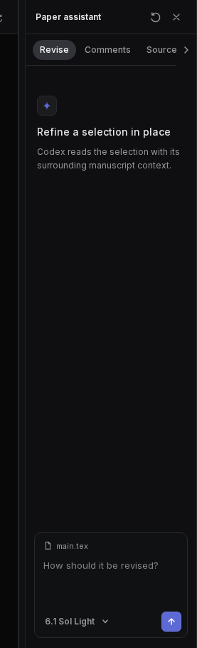
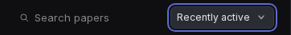

# 컴포넌트 재구성 운영 배포·실제 화면 확인 · 2026-10-27

[Paper Workspace](https://paper.glowme.kr)에 `20261027-085530-linear-components` 릴리스를 배포했다. 실제 운영 계정으로 로그인하여 데이터가 있는 원고·PDF·Rebuttal을 확인했다. 테스트 API 응답이나 로컬 fixture를 운영 확인에 사용하지 않았다.

## 배포 범위와 보존

- 최신 소스를 allowlist로 별도 디렉터리에 내보내고 고정한 후 이미지를 빌드했다. 작업 트리의 동시 변경을 되돌리지 않았다. 검증 후 별도로 추가된 작업은 이번 고정 릴리스에 섞지 않았다.
- 공유 환경에서 먼저 반영된 `20261027-084415-linear-remaining`의 완료와 healthy 상태를 확인한 뒤 이를 직전 버전으로 기록했다. 마지막 수정이 포함된 **workspace·password-gate 두 서비스만 교체**했다. 공개 로그인 폰트 경로가 반영된 Caddy와 나머지 서비스는 유지했다.
- 서비스 10개 모두 healthy다. 교체 전후 마운트 경로·볼륨·읽기/쓰기 설정의 차이는 0건이다. 이미지/빌드 경로를 제외한 Compose 실행 설정도 일치한다. 계정 암호·세션 비밀·권한·데이터 형식을 변경하지 않았다.
- SQLite 온라인 백업 두 개와 계정 레지스트리 사본, 직전 이미지 태그·롤백 설정을 비공개 릴리스 디렉터리에 보존했다. SQLite integrity_check를 통과했다. 운영 데이터 복원이나 볼륨 삭제는 실행하지 않았다. 이 사본은 같은 호스트의 복구 지점이며 외부 호스트 복제를 새로 수행한 것은 아니다.
- [실행 전 검사](design-refresh/production-components/preflight.json): 내보내기 비밀 패턴 검사 통과, Git 이력 1,305개 blob의 일치 0건, npm audit 취약점 0건. 마지막 설정·속성 메뉴·로그인·새 구성 [29개](design-refresh/production-components/preflight-browser-29.log)와 리뷰 편집/동기화·전환 [3개](design-refresh/production-components/preflight-review-3.log)가 고정 배포본에서 통과했다.

## 실제 운영 브라우저 검증

공식 DNS 응답의 공개 IP를 지정해 실제 `https://paper.glowme.kr`로 접속했다. TLS 인증서 검증은 유지했다. 호스트의 일반 DNS 조회가 불안정하여 Chromium의 주소 지정 기능을 사용했으며, 실제 Caddy·인증·서버 API·Yjs·PDF.js가 동작했다.

**확인 항목 170개 통과**, 로그인·허브·원고·리뷰 × 밝음/어두움 × 한국어/영어 × 320/390/1024/1600px의 **64개 화면 조합**에서 가로 넘침·페이지 오류 0건이다. [전체 검사 수치](design-refresh/production-components/verification.json).

| 확인 영역 | 실제 결과 |
| --- | --- |
| 로그인·접근 경계 | 개인 계정 로그인 성공, 미인증 자료/API 차단, 허용하지 않은 프로젝트 차단, 로그아웃 후 카탈로그 401. 로그인 공개 폰트는 내려받은 파일의 해시까지 대조했다. |
| 배포 파일 | 브라우저로 받은 JS/CSS 12개가 고정 릴리스와 일치했다. 컨테이너의 핵심 파일 11개도 일치하고 HTML 빌드 토큰·새 설정 마크업을 확인했다. [해시 확인](design-refresh/production-components/deployed-source-check.json). HTML은 빌드 중 해시 토큰이 치환되므로 치환 전 소스와 직접 비교하지 않았다. |
| 허브·프로젝트 선택 | 실제 카탈로그와 목록·열 머리글 표시, 정렬 옵션 메뉴 열기/Escape 복귀, 프로젝트 전환 메뉴의 실제 링크·검색/빈 결과를 확인했다. |
| 원고·PDF·도우미 | 실제 원고와 PDF.js 캔버스 표시, 5개 도구 전환, 하단 composer 위치, 모델 메뉴, 현재 파일 메뉴를 확인했다. 조작 전후 원고 해시가 같았다. |
| 테마 설정 | 모달 내부 property 메뉴에서 테마를 실제 변경하고 원래 값으로 복원했다. 설정 닫기와 포커스도 확인했다. 변경은 검증 브라우저의 로컬 설정이다. |
| 데이터가 있는 Rebuttal | 원문/답변 문서 pane, 라운드·리뷰어·문서 property 메뉴, 연결 표시 스위치의 키보드 조작과 복원을 확인했다. |
| 호출·변경 | LLM 요청 0건, 리뷰 데이터 변경 API 요청 0건. 원문 입력·규칙 적용·복원·리뷰 가져오기 확정은 실행하지 않았다. |

운영 화면의 안전한 컴포넌트 crop이다. 전체 캡처에는 실제 원고가 있으므로 비공개 릴리스 디렉터리에만 보존했다.

[운영 모바일 로그인](design-refresh/production-components/actual-login-mobile.png)도 확인했다. 캡처는 DPR1·폰트 로딩 완료·reduced-motion 조건이며 실제 이미지도 확인했다.

## 증거·정리·검증 한계

릴리스·빌드·롤백·DB 사본·전체 화면·상세 로그는 `~/.local/state/paper-workspace/releases/20261027-085530-linear-components/`에 보존했다. 인증 정보·세션 쿠키·비공개 원문은 이 보고서와 공개 검사 JSON에 넣지 않았다.

초기 검사 도구에서 생성 HTML을 치환 전 소스와 비교하거나 Node 요청 도구에 Chromium의 DNS 지정이 적용될 것으로 가정한 오류를 바로잡았다. DB 사본 생성은 권한을 제거한 컨테이너 root 대신 실제 서비스 사용자로 수행했다. 해당 도구 오류를 운영 UI 실패로 집계하지 않는다.

검증 세션은 로그아웃하고 브라우저와 이번 작업의 임시 검사 서버를 종료했다. 최종 서비스 상태·파일 해시·볼륨을 다시 확인했다. 별도 외부 단말·WebKit·실제 스크린리더 전체 감사나 운영 LLM/문서 수정·복원 실험은 이번 범위에 포함하지 않았다.
