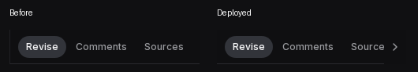

후속 화면 개편과 검증 범위는 [남은 화면 보고서](linear-remaining-2026-10-27.md)에 기록했다.

# 배포 및 사용성 검토 · 2026-10-27

후속 컴포넌트 배포와 실제 운영 확인은 [최신 배포 기록](deployment-components-2026-10-27.md)에 정리했다.
[Paper Workspace](https://paper.glowme.kr)에 반영했다. 작업공간과 로그인 화면을 배포하고, 실제 화면 검토에서 보완한 도우미 탭 이동 기능까지 추가 반영했다. 10개 운영 서비스가 모두 healthy이며 기존 볼륨·계정·프로젝트 권한 설정을 유지했다.

## 배포 결과

- 최초 릴리스: `20261027-071138-linear-usability` — 작업공간·로그인 이미지 교체.
- 최종 릴리스: `20261027-072410-linear-usability` — 도우미 탭 이동 보완. 이 단계에서는 작업공간만 교체했다.
- 작업 트리에서 allowlist로 깨끗한 소스를 내보내고 비밀 패턴을 검사했다. 실제 배포 Compose 구성과 비교해 이미지·빌드 경로 외 런타임 설정 차이가 없음을 확인했다.
- 이전 이미지·롤백 스크립트·마운트 목록·소스 해시를 보존했다. 백업 DB와 Rebuttal DB의 온라인 체크포인트를 만들고 SQLite integrity_check를 통과했다. 데이터 마이그레이션·볼륨 삭제는 없었다. 체크포인트는 이 호스트의 비공개 릴리스 디렉터리에 있으며 별도 호스트 복제는 이번 작업에서 수행하지 않았다.
- 최종 배포 파일의 SHA-256을 검증한 소스와 대조했다. 백엔드·Caddy·협업 서비스는 기존 이미지를 유지했다. 비공개 원문·자격증명·전체 화면 캡처는 저장소에 추가하지 않았다.

## 사용성 검토와 수정

| 우선순위 | 실제 문제 | 수정·근거 |
|---|---|---|
| P2 | Rebuttal 연결 스위치·우려 사항·화면 전환 후 키보드 포커스 유실 | 교체된 컨트롤에 포커스 복귀. 브라우저에서 Space/Enter로 실패를 재현한 뒤 회귀 검사와 실제 운영 리뷰에서 확인했다. |
| P2 | 검토 대기 중인 가져오기 자료와 재개 버튼이 닫힌 고급 도구 안에 숨겨짐 | 대기 건수와 재개 동작을 리뷰 작업공간 위에 노출했다. 실제 운영 자료에서도 발견 가능함을 확인했다. |
| P3 | 좁은 도우미 패널에서 마지막 작업 탭을 발견하기 어려움 | 넘칠 때만 좌우 이동 버튼과 스크롤 표시를 노출한다. 번역·폰트 로딩에 따른 탭 폭 변화도 관찰한다. 양 테마 10회 반복 및 실제 포인터 조작으로 검증했다. |
| P2 | Rebuttal 데이터 로딩 실패 시 논문 복귀 링크가 프로젝트·언어를 잃음 | 데이터 요청 전에 링크를 설정하고 언어를 URL에 유지한다. 정상 왕복과 로딩 실패 경로를 검사했다. |

실제 운영 도우미 영역의 전후 캡처다. 원문을 포함하지 않는 컴포넌트만 잘랐다.

허브 검색·정렬·진입, 모바일 내비게이션, 프로필·테마 대화상자, 규칙의 명시적 확인 흐름도 검토했다. 검토한 범위에서 남은 차단 문제는 발견하지 못했다. 이는 사용자 참여 연구나 모든 보조기기의 사용성 인증을 의미하지 않는다.

## 실행·검증 근거

- 전체 브라우저 **277개** 시나리오 실행: 마지막 전체 실행에서 276개 통과, 언어 유지로 기대 URL이 달라진 1개는 기대값을 갱신한 후 통과했다. 관련 왕복 시나리오 2개를 함께 재검증했다.
- 이후 탭 보완 영향 범위 38개 중 37개 통과. 남은 1개에서 번역 시점에 따른 버튼 누락을 발견해 수정했고, 해당 양 테마 시나리오 10회 반복이 모두 통과했다. 작업공간 레이아웃·모바일 전환·키보드 탭 검사 3개도 통과했다. 전체 277개를 보완 후 다시 실행했다고 보고하지 않는다.
- Python 플랫폼 **387개**, Node 서버·백업 **41개** 통과. 마지막 UI·배포 관련 Python **91개** 추가 통과. npm audit 취약점 0, JavaScript 구문과 `git diff --check` 통과.
- 깨끗한 내보내기 검사와 Git 전체 1,105개 blob의 저장소 비밀 패턴 검사에서 일치 0건. gitleaks 실행 파일이 없어 내보내기 스캐너를 사용했으며, 이를 gitleaks 실행 결과로 취급하지 않는다.
- 실제 운영 HTTPS에서 정상 계정 로그인·카탈로그·PDF.js 렌더링·도우미 전 탭·설정 초점 복귀·데이터가 있는 Rebuttal·연결 스위치·로그아웃을 확인했다. 미인증 자료/API 401, 미허용 프로젝트 403, 로그아웃 후 카탈로그 401을 확인했다.
- 로그인·허브·원고·Rebuttal × 양 테마 × 320/390/1024/1600px의 **32개 조합**에서 문서 가로 넘침 0건, 페이지 오류 0건. 한국어·영어로 캡처하고 폰트 로딩과 motion을 통제했다. 실제 캡처를 직접 확인했다.
- 정상 공개 DNS A 레코드를 HTTPS DNS로 확인하고, 공개 IP를 지정한 HTTPS 요청과 브라우저로 검사했다. 인증서 검증은 유지했다. 호스트의 일반 DNS 조회와 외부 웹 도구는 실패해 이 대체 경로를 사용했다. 외부 단말의 전체 네트워크 경로까지 검증한 것은 아니다.
- 운영 LLM 호출은 **0건**이다. 문서 편집·새 규칙 적용·복원·리뷰 가져오기 확정 같은 운영 데이터 변경 실험은 하지 않았다. 해당 기능·실패·복구는 격리된 기존 회귀 검사로 확인했다.

[운영 검사 JSON](design-refresh/deployment-usability/production-evidence.json)은 내용·자격증명 없이 상태와 크기 검사만 담는다. 세부 로그·전체 캡처·롤백 스크립트는 `~/.local/state/paper-workspace/releases/<릴리스>/`의 비공개 기록에 보존했다.

## 시나리오 행렬

| ID | 사용자·상황 | 실행 | 기대 신호와 결과 | 증거·정리 |
|---|---|---|---|---|
| UX01 | 키보드 사용자 | `rebuttal.spec.js` 컨트롤 회귀·운영 Space | 재현 후 수정, 포커스 유지 | 실패/통과 로그 보존, 테스트 유지 |
| UX02 | 가져오기 미리보기 취소·복귀 | staged import·운영 대기 자료 | 고급 도구가 닫혀도 대기 자료 발견 | 정상 표시, 운영 자료 미변경 |
| UX03 | 포인터·지연된 번역/폰트 | `accessibility-contract.spec.js`·실제 버튼 클릭 | 모든 탭 발견·이동, 10회 통과 | 컴포넌트 캡처 보존 |
| UX04 | 데이터 로딩 실패·복귀·언어 변경 | 프로젝트 왕복·실패 상태 | 프로젝트·언어·커서 유지 | 수정 후 2개 통과 |
| DEP01 | 기존 사용자 변경·더티 작업 트리 | allowlist export·해시·Compose 비교 | 관련 변경만 배포, 기존 변경 보존 | 원본 작업 트리 reset 없음 |
| DEP02 | 미인증·미허용 프로젝트 | Caddy 경유 요청 | 401/403, 로그인 후 허용 범위만 표시 | 세션 로그아웃, 자격증명 출력 없음 |
| DEP03 | 정상 계정 사용자 | 공개 IP HTTPS 브라우저 | 로그인·실제 PDF·리뷰·설정·로그아웃 | 운영 14개 확인 항목 통과 |
| DEP04 | 모바일·데스크톱·양 언어/테마 | 32개 조합 | 가로 넘침·페이지 오류 0건 | 전체 캡처 비공개 보존 |
| EDGE01 | 긴 문구·불량 입력·오프라인·취소·복구 | 기존 플랫폼·협업·브라우저 회귀 | 경계·복구·명시적 실행 계약 유지 | 운영 장애 유발 대신 격리 검사 |
| EDGE02 | 콘텐츠 속 지시·가짜 성공 | 자료는 데이터로만 처리, exit code·health·해시 검사 | 콘텐츠 지시 실행·성공 문구만의 판정 없음 | LLM 0, 비밀 패턴 일치 0 |
| EDGE03 | 재시도·장기 명령·부분 실패 | 타임아웃·롤백·반복 검사 | 무한 대기·데이터 삭제 없음 | 최종 이미지와 이전 이미지 유지 |

## 실패·정리·한계

최초 보조 도구 실행에서 Compose 전용 YAML 태그 처리, 모바일에서 숨겨진 선택기 조작, 로그아웃 후 인증 wrapper, 마운트 배열 순서 비교가 검사 도구를 실패시켰다. 제품 문제와 구분해 도구를 수정했다. DB 체크포인트는 컨테이너의 작은 임시 저장소 한도를 넘어서 영속 저장소의 임시 경로에서 다시 생성하고 검증했다. 해당 임시 DB는 제거했다.

임시 브라우저·개발 서버·QA 상태를 정리한다. 회귀 테스트와 보고서·비공개 릴리스 증거는 의도적으로 보존한다. 사용자 변경이나 운영 데이터의 롤백은 수행하지 않았다. WebKit·실제 모바일 기기·스크린리더 전체 감사, 실제 외부 LLM 호출과 운영 데이터 복원 실험은 수행하지 않았다.
