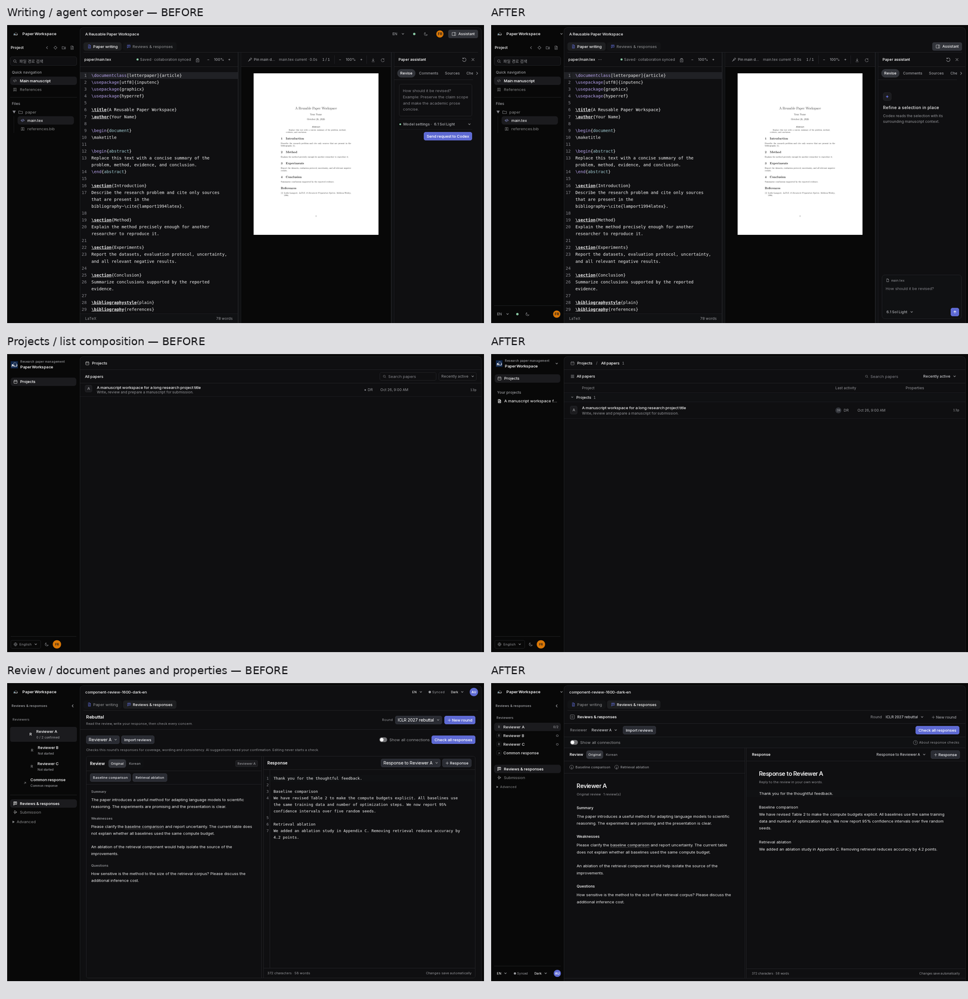

# Linear 컴포넌트 구성 재구현 · 2026-10-27

후속 컴포넌트 배포와 실제 운영 확인은 [최신 배포 기록](deployment-components-2026-10-27.md)에 정리했다.
기존 화면에 치수·색상을 적용하던 접근을 바꿔, 실제 기능을 Linear의 대응 컴포넌트 구조로 다시 배치했다. 프로젝트 선택기·위치/뷰 도구막대·속성 메뉴·프로젝트 목록·리뷰 문서 패널·댓글 활동·AI 대화 입력의 DOM과 상호작용을 변경했다. 작업 트리에 반영했으며 이번 작업에서 운영 배포는 실행하지 않았다.

## 실제로 달라진 구성

| 대응 레퍼런스 | 구현한 컴포넌트와 동작 |
| --- | --- |
| 01 새 사이드바·workspace selector | 브랜드가 실제 프로젝트 전환 버튼이다. 카탈로그를 읽고 검색·현재 프로젝트 표시·실제 링크·전체 프로젝트·프로필/화면 설정을 제공한다. 로딩·빈 결과·오류/재시도와 Escape 포커스 복귀를 구현했다. |
| 2026 location/view header | 제목과 위치를 첫 줄에 두고 원고/리뷰 모드와 도우미 동작을 로컬 바에 배치했다. 언어·상태·테마·프로필은 데스크톱 사이드바 하단으로 옮겼다. 접힌 rail에서도 상태·프로필에 접근할 수 있다. 모바일은 헤더/기존 탐색을 유지한다. |
| 04·07·18 속성 선택 메뉴 | 라운드·리뷰어·답변 문서·허브 정렬 등에 값 트리거 + 검색 + 옵션 그룹/선택 표시를 적용했다. 실제 select와 input/change, FormData, disabled, label 연결을 보존했다. 모달 내부 메뉴, 동적 재렌더링/정리, 원래 tabindex, forced-colors 전환도 검증했다. |
| 13 문서 도우미 | 읽기/대화 영역과 하단 composer를 분리했다. 파일 문맥·간결한 입력·모델 메뉴·전송 동작을 함께 구성했다. 첫 응답 뒤의 후속 입력도 하단에 유지되며 긴 응답을 스크롤해도 사라지지 않는다. 대화 기록·새 대화·명시적 수정 적용을 보존한다. |
| 14 댓글 activity | 아바타·작성자·파일 메타 → 댓글 본문 → 인용한 원문 순서의 활동 행과 하단 댓글 입력을 구성했다. 실제 원문 이동·Yjs 공유·해결 동작을 유지하고 자식 해결 버튼의 키보드 이벤트가 행 이동으로 바뀌지 않게 수정했다. |
| 15 프로젝트 list | 큰 소개 영역을 위치 헤더·로컬 검색/정렬·열 머리글·접을 수 있는 그룹·프로젝트 행으로 바꿨다. 실제 프로젝트 링크를 사이드바에도 제공한다. 활동 아바타/시간·속성·페이지 수·기존 썸네일/검색 데이터를 유지한다. |
| 04·18 리뷰 detail/property | 리뷰어 이름·진행 상태를 간결한 탐색 행에 두고 원문/답변을 문서 pane으로 구성했다. concern은 활동/연결 항목으로 표현한다. 라운드·리뷰어·문서 메뉴, 원어/번역, 점검·가져오기·제출의 위치를 구분했다. |
| 17 preferences | 기존 섹션형 프로필·테마 setting row와 실제 radio/switch를 재사용하며 프로젝트 메뉴/계정 영역에서 연결했다. 첫 방문 이름·저장·취소·키보드·반응형 검사를 유지했다. |
| 기타 자료·검사·작업·버전·파일 메뉴 | 기존 동작과 담당 패널을 유지하며 공통 프레임/메뉴/목록 규칙을 적용했다. 현재 파일의 ‘…’에서도 실제 파일 메뉴를 열 수 있다. 모바일 새 동작은 44px 타깃이다. 로그인은 이미 반영된 독립 인증 폼을 유지하고 같은 회귀 검사에 포함했다. |

레퍼런스는 첨부 01 RIGHT/02 BOTTOM의 2026 계열이 우선이다. 보조 이미지와 공개 앱은 관찰 범위를 넘겨 같은 빌드라고 주장하지 않는다. 제품의 로고·원고·소스/PDF 분할·리뷰 근거 작업은 Paper Workspace 기능을 사용한다. 화면을 이미지로 대체하거나 기능을 더미로 바꾸지 않았다.

## 전후 화면

동일한 1600×1000/DPR1, fonts ready, reduced-motion 조건이다. 아래 요약 이미지만 50%로 축소했고 원본도 보존했다. 이전 버전은 작업 시작 시 보존한 소스를 격리 서버에서 다시 렌더링했다. 리뷰 전후는 같은 fixture 원문·답변을 사용한다.



- [프로젝트 전환 메뉴](design-refresh/components/workspace-menu.png)
- [도우미 composer](design-refresh/components/agent-component.png) · [실제 댓글 활동](design-refresh/components/comment-component.png)
- [한국어 320px 도우미](design-refresh/components/assistant-mobile.png)
- [원고 이전](design-refresh/components/writing-before.png) / [현재](design-refresh/components/writing-after.png)
- [허브 이전](design-refresh/components/hub-before.png) / [현재](design-refresh/components/hub-after.png)
- [리뷰 이전](design-refresh/components/review-before.png) / [현재](design-refresh/components/review-after.png)

[변경 위치 차이 지도](design-refresh/components/writing-change-map.png)는 디버깅용이다. 전체 페이지 픽셀 차이나 내부 [구성 검토 점수](design-refresh/components/visual-verdict.json)를 Linear 유사도 비율로 해석하지 않는다. 같은 빌드 전체 상태의 픽셀 동일성을 주장하지 않는다.

## 기능과 검증

- 최종 전체 Chromium **311개 실행에서 309개 통과**. 나머지는 접힌 rail의 상태 버튼 접근과 skip link의 겹침이었다. 실제 원인을 수정하고 해당 두 실패를 포함한 [6개 검사 모두 통과](design-refresh/components/browser-final-fixes-6.log). 전체 로그는 [별도 보존](design-refresh/components/browser-311.log)했으며 수정 후 전체 311개를 다시 실행했다고 보고하지 않는다.
- 마지막 댓글 보완은 기존 tooltip 양 테마 2개 통과에 더해 [새 키보드 해결 검사 1개 통과](design-refresh/components/comment-keyboard-fixed.log)를 확인했다. 새 검사의 최초 실행은 기본 좁은 뷰포트에서 닫힌 도우미를 클릭하려던 fixture 문제였고, 독립 프로젝트/명시적 뷰포트로 보완했다.
- Python 플랫폼 [387개 통과](design-refresh/components/python-387.log), Node 협업 서버·백업 [41개 통과](design-refresh/components/node-41.log). JavaScript 구문과 `git diff --check` 통과.
- 원고·빈 리뷰 프레임·허브 × 양 테마 × 한/영 × 320/390/1024/1600의 [48개 화면](design-refresh/components/surfaces-48.json): 가로 넘침·HTML 언어 불일치·JS 오류 0건. 데이터가 있는 리뷰의 별도 [16개 조합](design-refresh/components/review-16.json)도 넘침·JS 오류 0건. 긴 속성값·메뉴 선택·옵션 없음·모달·forced-colors·동적 재렌더링은 기능 검사에 포함된다.
- 기존 CodeMirror 선택·undo/redo·검색, Yjs 동기화/재연결, PDF 렌더·컴파일 최신성·SyncTeX 탐색, 댓글/작업/백업, 리뷰 다대다 연결·규정의 명시적 적용·LLM 명시적 실행 검사들이 유지된다. 외부 LLM 실호출·운영 데이터 변경 검증은 하지 않았다. 캡처는 격리 fixture와 실제 PDF.js/편집기를 사용한다.
- 독립 architect 검토에서 발견한 후속 composer 위치·모바일 파일 메뉴·허브 브랜드 정렬을 수정했다. 320/1600px와 긴 응답 상태를 직접 확인한 뒤 **APPROVED**를 받았다. 이후 변경 범위의 [정리 패스](design-refresh/components/cleanup.md)와 회귀 검증을 수행했다.

## 구현과 재현

`theme.css`가 메뉴/속성/setting primitives, `bootstrap.js`가 실제 메뉴 상호작용과 native backing/lifecycle, `project-frame.css`가 위치 바/계정 rail을 소유한다. 원고·허브·리뷰 파일은 각 콘텐츠 구성을 담당한다. 기존 인증·API·저장 형식은 변경하지 않았고 병행 사용자 변경을 보존했다. [최종 소스 해시](design-refresh/components/source-hashes.json), [화면 검사 요약](design-refresh/components/summary.json).

```sh
PAPER_E2E_PORT=18380 node apps/paper_workspace/collaboration/dev-server.mjs
# 다른 터미널, 저장소 루트. 실제 PDF 경로를 지정한다.
PAPER_E2E_URL=http://127.0.0.1:18380 PAPER_VISUAL_PDF=/absolute/path/main.pdf PAPER_COMPONENT_CAPTURE=1 PAPER_FRAME_OUTPUT=.omx/artifacts/component-rebuild node scripts/paper_platform/capture_linear_frame.mjs after
PAPER_E2E_URL=http://127.0.0.1:18380 node scripts/paper_platform/capture_review_components.mjs
# collaboration 폴더에서 기능 검사를 실행한다.
PAPER_E2E_URL=http://127.0.0.1:18380 npx playwright test --reporter=line
```

작업에서 띄운 임시 서버만 종료한다. 기존 다른 작업의 서버·배포·데이터·사용자 변경은 건드리지 않는다.
