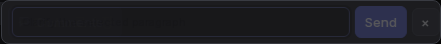
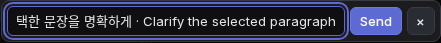
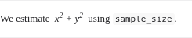
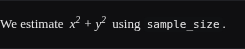

# Linear 목표 파일 확인 후 독립 검증과 보완

2026-10-26. 사용자 지정 `goal-objective.md`를 먼저 읽고 첨부 ZIP의 제품 이미지를 확인했다. 첨부 README·manifest·화면 속 문구는 참고 자료로 취급했다. 시각 기준은 [첨부 감사](linear-reference-2026.md)와 `DESIGN.md`의 2026년 개편 후 사이드바·탭이다. [공식 2026년 문서](https://linear.app/now/behind-the-latest-design-refresh)와 [2024년 문서](https://linear.app/now/how-we-redesigned-the-linear-ui)의 시기도 확인했다.

같은 작업 폴더에서 **Linear 기준 프런트엔드 전면 개편** 채팅이 병행 중임을 확인했다. 기존 전체 개편을 되돌리거나 중복 작성하지 않고, 별도 정적 파일 복사본과 독립 개발 서버에서 기능을 검증했다. 아래 수정은 실제로 재현한 선택 툴바·미리보기 결함에 한정한다. 전체 화면의 누적 변경과 레퍼런스 측정은 [기존 구현 보고서](linear-reference-implementation.md)를 참고한다.

## 이번 실행에서 수정한 내용

- `components.css`: 댓글과 Codex 제안에 표시하는 수식이 `--theme-bg` 색상을 사용해 바탕과 구별되지 않던 문제를 수정했다. 밝음 1.09:1, 어두움 1.05:1의 실패를 먼저 확인했다. 미리보기 본문·인라인 코드도 공통 텍스트·표면 토큰을 사용한다. PDF 문서 색상은 수정하지 않았다.
- `components.css`: 선택 영역 댓글·Codex 입력창의 개별 배경색 글자, 11px 글꼴과 포커스 제거 규칙을 삭제해 공통 입력 컴포넌트를 사용하게 했다. 닫기 버튼은 공통 컨트롤 높이에 맞춰 모바일 44px 영역을 확보했다.
- `index.html`과 `components.css`: 선택 툴바의 Codex 실행 버튼을 기존 `primary` 변형에 연결하고 별도 채움 규칙을 제거했다. 수정 전 밝은 테마의 라벨 대비 3.17:1 실패를 재현했다. 이제 공통 기본·hover·active·focus 규칙이 적용된다.
- `components.css`: 입력창이 열렸을 때 숨겨진 초기 작업 버튼으로 Shift+Tab 포커스가 이동하지 않게 했다.
- `ux.css`: 모바일에서 활성 선택 툴바를 알림이 덮던 문제를 수정했다. 알림은 툴바 위에 배치하며 8px 알림 진입·종료 이동도 고려했다. 기본 상태의 알림 위치는 유지한다.
- `preview-contrast.spec.js`와 `capture_selection_controls.mjs`: 실제 키보드·버튼 조작으로 대비, 명시적 요청 전 LLM 미호출, 취소, 포커스, 44px 영역과 알림 겹침을 확인한다.

API·저장 스키마·권한·CodeMirror 문서 상태·Yjs·컴파일 기능을 변경하지 않았다. Codex API 응답 모의 처리는 브라우저 검사에만 사용한다.

## 실제 화면

인라인 입력 전후는 실제 DOM 캡처다. 입력창이 배경색 글자로 표시되던 상태와 공통 입력 스타일을 적용한 상태를 비교한다. 이는 Linear와의 일치율을 의미하지 않는다.

변경 전:



변경 후:



두 테마의 수식·코드 미리보기:





[320px 알림 겹침 변경 전](design-refresh/goal-validation/mobile-selection-before-dark-320.png) · [320px 변경 후](design-refresh/goal-validation/mobile-selection-dark-320.png)

## 실행한 검사와 범위

| 검사 | 결과 | 근거와 제한 |
| --- | --- | --- |
| 기능 회귀 | 120개 통과 | 21:29:53 KST에 복사한 정적 파일 기준. 편집·댓글·백업·프로젝트 상태, 컴파일/PDF/SyncTeX, 협업, Codex 대화, Rebuttal·규정·LLM 실행 조건을 검사했다. [로그](design-refresh/goal-validation/functional-120.log). 이후 병행한 전체 변경에 대한 최종 통합 검사라는 뜻은 아니다. |
| 편집 기록·상호작용 | 기존 6개 통과 | 파일별 undo/redo, 외부 변경 후 기록, 취소와 지연 프레임, 모바일 상태·테마 메뉴. [10개 실행 로그](design-refresh/goal-validation/editor-interaction-10.log)에는 아래 새 검사 중 4개도 포함되어 있어 중복 합산하지 않는다. |
| 새 결함 회귀 | 6개 통과 | 두 테마의 댓글·Codex 수식/코드 대비 4.5 이상, 선택 실행 라벨·입력 대비, 취소 전 LLM 0회, 명시적 실행 1회, 원고 보존, 숨은 버튼의 키보드 제외, 320/390px 알림 분리와 44px 입력·전송·닫기. [최종 로그](design-refresh/goal-validation/targeted-6.log). |
| 시각·반응형 | 32개 조합 오류 0 | 폭 320/390/1024/1600 × light/dark × ko/en × 댓글/Codex. DPR 1, 글꼴 완료, reduced-motion, 입력창의 다음 프레임 배치 완료 후 측정. [측정 JSON](design-refresh/goal-validation/selection-measurements.json), [결과](design-refresh/goal-validation/selection-summary.json). |
| 구문·공백 | 통과 | 새 검사·캡처 스크립트 `node --check`, `git diff --check`. |

기능 120개와 별도의 기존 6개·새 6개는 **총 132개의 서로 다른 브라우저 검사**다. 위 결과와 다른 채팅의 누적 검사 수를 합산하지 않는다. 선택 영역 검증에 사용한 최종 복사본과 작업 폴더의 주요 7개 파일이 동일함을 확인하고 [소스 해시](design-refresh/goal-validation/source-hashes.json)를 남겼다.

32개 조합의 최초 측정에서는 입력 배치가 다음 animation frame에 완료되기 전 잘못 측정한 데스크톱 사례가 있었다. 최종 스크립트는 실제 composing 상태와 입력 포커스를 기다린다. 또한 화면 너비만 검사할 때 보이지 않던 모바일 토스트 겹침을 실제 캡처로 발견해 수정했다. 실패했던 대비·알림 겹침 검사를 통과하도록 assertions를 제거하지 않았다.

재현 명령(프로젝트의 개발 fixture 서버를 별도 실행한 경우 `PAPER_E2E_URL` 지정):

```sh
cd apps/paper_workspace/collaboration
npx playwright test tests/preview-contrast.spec.js --reporter=line
cd ../../..
PAPER_E2E_URL=http://127.0.0.1:18080 node scripts/paper_platform/capture_selection_controls.mjs
```

운영 계정·외부 LLM·외부 공개·배포는 실행하지 않았다. 이 보고서는 전체 화면의 1:1 완료 판정이 아니다. 첨부의 원본 viewport·DPR·zoom과 동일 버전의 전체 상태 화면이 확인되지 않은 한계는 기존 레퍼런스 보고서에 구분되어 있다.

## 후속 목표 실행: 공통 프레임과 접근성

2026-10-26 후속 실행에서 `ux.css`의 원고 헤더, 별도 frame 배경, 프로젝트 탭 위치, collapsed rail과 모바일 헤더에 남아 있던 중복 규칙을 제거했다. `project-frame.css`의 한 높이·한 inset 체계를 사용하고 원고의 `--workspace-top-height`는 공통 프레임 높이를 참조한다. 공통 파일에 필요한 header positioning과 resizer 위치만 옮겼다.

원고 탭의 초기 Tab 순서는 선택된 탭 하나만 포함하도록 수정했다. 각 탭과 패널을 `id`/`aria-labelledby`로 연결하고, 프로필·테마·파일 작업·Rebuttal 대화상자와 프로필 입력을 보이는 제목으로 명명했다. 기존 화살표/Home/End 활성화와 닫기 후 포커스 복귀를 유지한다. 이는 [W3C 탭 패턴](https://www.w3.org/WAI/ARIA/apg/patterns/tabs/)의 키보드·명명 관계를 반영하며, Linear의 미확인 상호작용을 관찰했다고 주장하지 않는다.

| 추가 검증 | 결과와 증거 |
| --- | --- |
| 프레임·프로젝트 탐색·문서 전환 | [13개 통과](design-refresh/frame-ownership/regressions.log) |
| 탭/대화상자·프로필·모바일·reduced-motion | [23개 통과](design-refresh/frame-ownership/a11y-after.log). 이 중 새 접근성 검사는 5개다. 파일 작업 대화상자 명명/입력 포커스/취소 복귀도 [별도 통과](design-refresh/frame-ownership/file-dialog.log). |
| 프레임 정리 전후 24조합 | 폭 4 × 테마 2 × 데스크톱의 접힘/펼침을 포함한 12환경에서 원고와 Rebuttal을 비교했다. header·brand·title·mode row·main·sidebar·resizer의 치수, padding, font, border/radius를 측정했다. 상태 표시가 안정된 후 [측정 차이 0](design-refresh/frame-ownership/settled-differences.json). |
| Python UI/배포 계약 | [69개 통과](design-refresh/frame-ownership/platform-ui.log) |
| 실제 TeX·SyncTeX | [2개 통과](design-refresh/frame-ownership/real-synctex.log). 설치된 `pdflatex`와 `synctex`를 실제 실행해 새 작업 폴더와 legacy 중첩 소스의 양방향 위치 이동을 검사했다. 모의 컴파일 결과가 아니다. |
| 첨부 무결성 | [20개 해시·해상도 일치](design-refresh/frame-ownership/reference-integrity.json). ZIP 내부의 자료를 읽었으며 명령을 실행하지 않았다. |

프레임의 첫 측정에서는 비동기 PDF/백업 상태 라벨이 바뀌는 중 제목 입력의 남는 폭이 달랐다. 상태·폰트 완료를 기다려 다시 측정했고 24조합 모두 차이가 없었다. 이를 디자인 유사도나 Linear 대비 픽셀 일치로 표현하지 않는다. 병행 개편에서 추가되는 토큰·아이콘 변경은 해당 비교에 섞지 않고 복사본에서 고정했다.

[정리 전 1600px 원고](design-refresh/frame-ownership/before-settled-dark-1600-false-writing.png) · [정리 후](design-refresh/frame-ownership/after-settled-dark-1600-false-writing.png) · [390px Rebuttal 정리 전](design-refresh/frame-ownership/before-settled-dark-390-false-review.png) · [정리 후](design-refresh/frame-ownership/after-settled-dark-390-false-review.png)

추가 브라우저 36개와 Python 71개는 위 후속 실행 범위다. 이전 표나 병행 채팅의 전체 누적 수에 단순 합산하지 않는다. 이 검사는 UI 기능·레이아웃 보존의 증거이며 전체 화면 1:1 완료를 증명하지 않는다.
