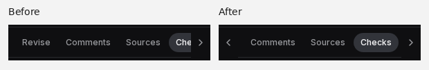
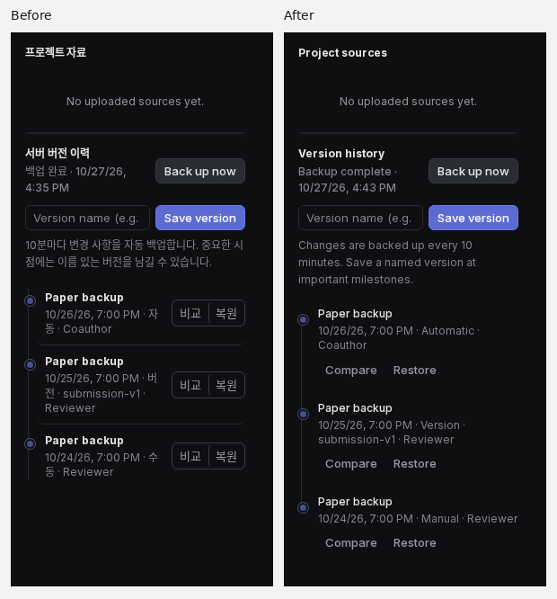
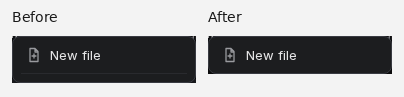

# 운영 화면과 Linear 컴포넌트 재비교 · 2026-10-27

운영 화면을 첨부 레퍼런스와 다시 비교해 도우미 탭, 백업 이력, 파일 메뉴의 남은 차이를 수정하고 배포했다. 최신 연결 기능 배포 위에 프런트엔드 세 파일과 HTML 캐시 해시만 적용했다.

후속 요청으로 아래에 기록했던 기존 테스트 실패 4개도 현재 UI 구조에 맞게 수정했다. 검증 결과는 문서 마지막의 **테스트 계약 동기화**에 정리했다.

| 비교 영역 | 발견한 차이와 수정 |
| --- | --- |
| 01/02 탭·탐색, 13 도우미 | 선택된 Checks/Tasks 등이 잘리는 경우가 있었다. 넘칠 때 양쪽 스크롤 버튼 공간을 유지하고 끝에서는 비활성화한다. 실제 탭 선택·패널 크기·폰트·언어 변경 뒤 선택 라벨 전체를 표시한다. |
| 14 활동 영역 → 백업 이력 | 반복되는 카드 하단 테두리와 혼잡한 메타/작업 배치를 연속 활동 행으로 교체했다. 제목·날짜/종류/작성자·낮은 강조의 비교/복원 순서다. 제목은 전체 폭에서 줄바꿈하고 마지막 연결선은 끝낸다. 영어 헤더·상태·버튼 번역을 보완하고 실제 작성자·버전 이름은 보존한다. |
| 05/07 메뉴 구조 → 파일 메뉴 | 보호된 원고/루트에서는 이름 변경·삭제가 숨겨져 메뉴 끝에 구분선만 남았다. 뒤의 작업 그룹이 있을 때만 구분선을 표시한다. |
| 07 속성 메뉴, 17 환경설정 | 실제 운영 캡처와 대응 레퍼런스를 확인했다. 이번 비교에서 재구성이 필요한 차이는 찾지 못해 현재 기능을 유지했다. |

첨부 **01 RIGHT / 02 BOTTOM의 2026 계열**을 우선했다. 07·13·14·17은 대응 컴포넌트 구조의 근거이며, 버전이 확인되지 않은 보조 캡처를 같은 빌드라고 간주하지 않았다. PDF/원고 분할, 백업 기능과 문구, Folio 로고는 제품 차이다. 최근 사용자 변경인 직접 허브 이동, 책갈피 모드 탭, 리뷰 iframe·Markdown 미리보기·연결 UI를 이전 상태로 되돌리지 않았다.

## 전후 증거

아래는 **운영에서 추출한 이전 소스와 최종 후보**를 같은 로컬 fixture로 렌더링한 컴포넌트 크롭이다. 1600×1000, DPR 1, 폰트 로딩 완료, reduced-motion 조건이며 크롭은 원래 크기다. 실제 운영 원고·작성자·프로젝트 정보가 담긴 전체 캡처는 비공개로 보관했다.







개인 내용이 없는 **실제 최종 운영** 크롭: [밝은 탭](design-refresh/live-comparison/production-tabs-light.png), [어두운 탭](design-refresh/live-comparison/production-tabs-dark.png), [파일 메뉴](design-refresh/live-comparison/production-file-menu-dark.png).

탭 선택의 관찰 결과는 동일 fixture의 12개 테마·언어·탭 캡처에서 잘림 4개 → 0개다. 내부 [컴포넌트 판정](design-refresh/live-comparison/visual-verdict.json)은 정성 검토이며 Linear 전체 유사도 비율이나 픽셀 동일성을 뜻하지 않는다.

## 검증 결과와 한계

- 관련 검사 **27개 통과**: [초기 29개 중 25개](design-refresh/live-comparison/regressions-initial-29.log) + [추가 2개](design-refresh/live-comparison/remaining-and-backup-2.log). 새 회귀 7개는 선택 라벨 노출·보호 파일/일반 파일/폴더 메뉴·백업 구조·작성자 보존·키보드 접근을 검사한다.
- 백업 제목/영문 상태 보완 후 [8개 통과](design-refresh/live-comparison/backup-refinement-8.log). 최종 전체 폭 활동 행으로 정리한 후 영향받는 [백업 2개](design-refresh/live-comparison/final-backup-2.log)와 [16조합 컨트롤 검사 1개](design-refresh/live-comparison/final-layout-1.log)를 다시 통과했다. 반복 실행을 별도 고유 검사 수로 더하지 않았다.
- 초기 검사에서 **기존 실패 4개**가 있었고, 수정하지 않은 배포 기준 소스로도 [같은 4개 실패를 재현](design-refresh/live-comparison/baseline-existing-failures.log)했다. 두 검사는 현재 책갈피 모드 탭에 이전 둥근 pill의 색/반경을 기대한다. 하나는 현재 select 대신 예전 테마 radio를 찾는다. 하나는 iframe 내부 리뷰 버튼을 상위 문서에서 찾는다. 사용자 기능을 되돌리거나 검사를 삭제해 숨기지 않았으며, 이번 작업에서 전체 회귀가 모두 통과했다고 주장하지 않는다.
- JavaScript 구문 및 변경한 소스/검사 파일의 `git diff --check` 통과. 이번 프런트엔드 범위를 넘는 전체 Python/Node 검사는 반복하지 않았다.
- **최종 실제 운영**: 밝은/어두운 × 한/영 × **320·390·1024·1600px의 16조합**, 탭 전환 **80회** 통과. 선택 라벨, 백업 제목/작업 영역, 원문 유지, 메뉴 구분선, 가로 넘침 0, 브라우저 오류 0, LLM 요청 0을 확인했다. 실제 HTTP로 받은 세 파일 SHA-256과 HTML 캐시 키도 검증본과 일치한다. [운영 검증 JSON](design-refresh/live-comparison/production-verification.json) · [로그](design-refresh/live-comparison/production-verification.log).
- 운영 검증은 편집·복원·LLM 작업을 누르지 않았다. 페이지가 열리면서 기존 자동 백업 확인/저장과 원고 페이지 수 메타데이터 갱신은 실행됐다. 비공개 원고 데이터는 결과 문서에 복사하지 않았다.

## 배포

이번 수정 릴리스: `paper-workspace-workspace:20261027-164230-linear-visual-audit`.

확인 도중 병행 작업의 `paper-workspace-workspace:stale-connection-notice-20261027` 배포가 추가로 반영됐다. 새 배포에서도 이번 세 파일과 HTML 해시가 모두 유지된 것을 확인했으며, 양 테마 1600px에서 탭 전환 10회와 실제 HTTP 파일 해시를 추가 확인했다. 서비스 10개도 정상이다. 새 배포를 되돌리지 않았다. [최종 실행 상태](design-refresh/live-comparison/final-running-verification.json) · [추가 화면 검사](design-refresh/live-comparison/successor-verification.log).

실행 중이던 이미지에서 새 이미지를 만들고 `app.js`, `components.css`, `workspace-i18n.js`, 해당 캐시 해시를 담은 `index.html`만 교체했다. Compose 설정 계층 **54개**를 보존하고 workspace 이미지 override 하나를 추가했다. 구성 비교에서 이미지 외 설정은 동일하다. 동시 배포가 있으면 중단하도록 컨테이너 ID를 확인했고, 최종 **workspace만 교체 / 서비스 10개 정상 / 마운트 변경 0개**를 확인했다. 운영 DB의 온라인 백업과 이전 이미지/롤백 명령은 비공개 릴리스 디렉터리에 보관했다.

[사전 확인](design-refresh/live-comparison/preflight.json) · [최종 소스 해시](design-refresh/live-comparison/source-hashes.json). 백엔드·게이트·Caddy·계정·공유 데이터는 이번 배포에서 교체하지 않았다.

재현 가능한 로컬 회귀:

```sh
# collaboration 디렉터리. 전용 격리 개발 서버 URL을 사용한다.
PAPER_E2E_URL=http://127.0.0.1:19120 npx playwright test linear-live-fidelity.spec.js remaining-controls.spec.js
```

범위는 실제로 확인한 대응 컴포넌트와 공개 가능한 증거다. 모든 Linear 화면/상태의 같은 버전 픽셀 동일성을 주장하지 않는다.


## 후속: 테스트 계약 동기화

기존 실패 4개를 담당하는 테스트 두 파일을 현재 UI 계약으로 수정했다.

| 검사 | 현재 확인하는 계약 |
| --- | --- |
| 밝은/어두운 테마의 컨트롤 계층 2개 | 두 모드 링크와 단일 `aria-current="page"`, 표면에 연결된 책갈피 탭의 배경·위쪽 모서리·열린 아래쪽 경계, 비선택 상태를 확인한다. 기존 실제 hover/pressed/포커스/loading 검사도 유지했다. |
| 강제 색상 모드 1개 | 실제 테마 `select`를 접근 가능한 combobox로 찾는다. 네이티브 외형·노출·키보드 포커스, dark 선택의 실제 테마/저장값 반영, 대화상자 종료와 재개 시 값 유지까지 확인한다. 언어 select의 변경 검사도 유지했다. |
| 리뷰 대화상자 1개 | 일반 리뷰 진입 경로의 활성 `paper-review-frame` 안에서 실제 빈 화면의 ‘Create your first round’를 클릭한다. 대화상자 이름과 제목 입력의 접근성, Escape 종료, 실제 트리거로 포커스 복귀를 확인한다. 숨겨진 예전 `#new-round` 헤더 버튼이나 standalone 경로로 우회하지 않는다. |

현재 저장소 소스로 관련 **15개 고유 검사 모두 통과**를 확인했다. [첫 15개 실행](design-refresh/live-comparison/current-contracts-initial-15.log)에서 14개 통과 후, 리뷰의 숨겨진 헤더 버튼 참조를 실제 빈 화면 버튼으로 고치고 [영향받는 1개를 재실행해 통과](design-refresh/live-comparison/current-review-contract-final-1.log)했다. 이미 통과한 14개는 추가 수정이 없어 반복하지 않았다. 수정 전 통과 결과와 마지막 영향 검증을 합친 수이며, 마지막에 15개 전체를 다시 실행했다는 뜻은 아니다.

[검증 요약과 테스트 소스 해시](design-refresh/live-comparison/current-contract-verification.json). 두 테스트 파일의 JavaScript 구문 및 공백 오류 검사도 통과했다. 테스트 생략·실패 무시 설정을 추가하지 않았으며, 이 후속 작업은 테스트와 검증 기록에 한정했다.


### 15개 전체 단일 실행 재확인

사용자 요청으로 두 파일의 관련 테스트 **15개를 한 번의 Playwright 실행으로 다시 실행해 15개 전부 통과**했다. 실행 시간 10.0초, 실패·생략 0개다. 위의 단계별 검증에 더해 전체 단일 실행도 확인한 결과다. [전체 실행 로그](design-refresh/live-comparison/current-contracts-full-15.log) · [갱신된 검증 요약](design-refresh/live-comparison/current-contract-verification.json).

```sh
# apps/paper_workspace/collaboration 디렉터리에서 실행
PAPER_E2E_PORT=19210 npx playwright test linear-reference-controls.spec.js accessibility-contract.spec.js --workers=2 --reporter=line
```


## 후속: 전체 회귀 검사

현재 작업 트리의 전체 회귀 **846개(브라우저 381·Python 424·Node 41)**가 통과했다. 추가로 발견한 터치/모바일 탐색, 뷰 사이 언어 유지, 대화상자 포커스, 미완료 가져오기·번역 진입을 수정했다. [전체 결과와 수정 기록](full-regression-2026-10-27.md).
