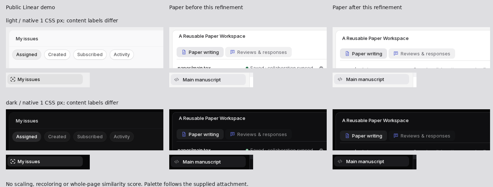

# 실제 Linear 공개 프레임과 추가 보정 · 2026-10-27

공개 앱에서 확인한 기하를 기준으로 원고·Rebuttal·허브의 탐색 행과 프레임을 추가 보정했다. 2026-03-12 첨부 이미지가 우선 기준이며, 공개 데모의 서로 다른 색상으로 기존 토큰을 덮어쓰지 않았다.

## 직접 확인한 범위

[공식 시작 가이드](https://linear.app/docs/start-guide)가 연결하는 [공개 데모의 My issues 화면](https://linear.app/demo/my-issues/assigned)을 Chromium에서 양 테마로 렌더링했다. 로그인하지 않았고 Linear의 API·문서·이슈를 변경하지 않았다. 초기 CDN 전체 자산 전송의 connection reset은 64KiB HTTP byte range를 검증·재조합하여 해결했다. 브라우저에는 내려받은 공개 자산 바이트를 그대로 제공했다. API 응답이나 화면을 모의로 대체하지 않았다.

- 조건: 1600×1000 CSS px, DPR 1, visualViewport.scale 1, 글꼴 로딩 완료, reduced-motion. [밝은 원본](design-refresh/live-frame/reference/linear-demo-light-1600.png), [어두운 원본](design-refresh/live-frame/reference/linear-demo-dark-1600.png).
- 저장소의 재현 스크립트도 양 테마 캡처에 성공했고 오류 0건이었다. [재현 로그](design-refresh/live-frame/public-demo-reproduce.log), [현재 밝은 캡처](design-refresh/live-frame/reference/public-demo-light-1600.png), [현재 어두운 캡처](design-refresh/live-frame/reference/public-demo-dark-1600.png), [자산 해시 목록](design-refresh/live-frame/reference/public-assets.json).
- 원본은 작업공간 설정 중이었고, 재현에서는 밝은 화면의 설정 문구가 사라졌지만 이슈 목록은 비어 있었다. 프레임·탐색·헤더만 근거로 사용한다. 목록·메뉴를 관찰했다고 확대 해석하지 않는다. 생성 창은 아래의 별도 관찰로 구분한다.
- 이어서 New issue 창을 열고 Create issue 컨트롤이 실제로 로드될 때까지 기다렸다. 입력·제출하지 않고 Escape로 닫았다. [어두운 창](design-refresh/live-frame/reference/public-create-issue-dark.png)과 [측정](design-refresh/live-frame/reference/public-create-issue-dark.json), [밝은 창](design-refresh/live-frame/reference/public-create-issue-light.png)·[측정](design-refresh/live-frame/reference/public-create-issue-light.json)을 보존했다. 현재 공개 창의 버튼은 28px/12px 글자·완전한 pill 반경이고, 첨부 05의 6px 계열 곡률과 다르다. 이 버전 차이를 전체 버튼에 섞어 적용하지 않았다.
- 공개 빌드가 첨부와 정확히 같은 빌드인지는 입증되지 않았다. 첨부의 래스터 색·탭 외형은 우선하며, 공개 앱은 이전에 추정했던 기하를 보정하는 보조 자료다. 2024 이미지는 섞지 않았다.

## 측정과 적용

| 항목 | 실제 공개 앱 측정 | 이전 Paper | 현재 Paper |
| --- | --- | --- | --- |
| 선택 탐색 행 높이 | 28px | 30px | 28px |
| 선택 탐색 행 반경 | 8px | 8px | 8px |
| 탐색 라벨 | 실제 텍스트 노드 13px/500 | 13px/500 | 13px/500, 18px 행간 |
| 작업면 위·오른쪽 여백 | 8px | 8px | 8px |
| 작업면 모서리 | 12px | 10px | 12px |
| 내부 위치 헤더 | 44px, y=9부터 | 바깥 48px에 제목 배치 | 위 여백 8px + 위치 행 44px |
| 제목 세로 중심 | y=30.5 | y=24 | y=30 |
| 허브 내부 헤더 | 44px | 48px | 44px |
| 사이드바 | 바깥 244px, 선택 행 205px | 기본 224px, 조절 가능 | 기본·저장된 조절 폭 보존 |

44px 위치 헤더와 그 위 8px 여백을 분리했다. 원고/Rebuttal의 별도 모드 행은 제품 기능을 위해 유지하여 데스크톱 전체 헤더는 92px이다. 모바일은 기존 48px 위치 행 + 44px 모드 행을 유지한다. coarse pointer의 44px 타깃도 유지한다. 파일·빠른 탐색·리뷰 탐색·허브가 공통 `--nav-row-height`를 사용한다.

제목 중심의 0.5px 차이는 Linear의 1px 경계가 포함된 헤더와 Paper의 편집 가능한 입력 배치 차이다. 244px 데모 사이드바의 내부 여백 원인은 확정하지 않았다. Paper의 기본 224px와 실제로 저장된 사용자 폭은 보존했고 이 차이를 숨기지 않는다. 첨부 01의 112px 행을 28px로 비교할 때의 4배 정규화는 원본 DPR·zoom의 증명이 아니다.

## 같은 배율의 비교

왼쪽부터 공개 Linear / 이번 보정 이전 / 현재다. 모든 crop은 원래 CSS px 크기이며 확대·재색상화하지 않았다. 두 제품의 문구와 기능은 다르다. 전체 페이지 픽셀 차이를 유사도 점수로 계산하지 않았다.



[수치 비교와 남은 차이](design-refresh/live-frame/comparison.json). 이전 이미지는 변경 전 CSS를 격리 복사본에서 다시 렌더링한 전후 비교이며 초기 전면 개편 전의 화면은 아니다. 초기 개편 전후는 [기존 보고서](linear-reference-implementation.md)에 있다.

## 검증과 함께 수정한 문제

- 이번 프레임 관련 41개 브라우저 검사는 37개가 먼저 통과했다. 이전 88px/48px를 기대하던 4개를 새 측정에 맞게 갱신하고 해당 4개가 통과했다. 반경·제목 중심·실제 파일/탐색 행 28px도 검사한다. [초기 로그](design-refresh/live-frame/browser-initial.log), [4개 수정 후](design-refresh/live-frame/browser-expectations-fixed.log).
- 프로젝트 탐색·전환 추가 검사 7개 중 6개가 먼저 통과했다. 캡처에서 한국어 원고 → 리뷰 화면의 언어가 유실되는 것을 확인하여 이동 링크에 현재 언어를 전달했다. 돌아오기와 리뷰에서 언어를 바꾼 뒤 이동하기도 검증했다. 테스트의 기본 프로젝트에는 실제 리뷰 상태가 없으므로 격리된 빈 상태 fixture를 명시했다. [6개 통과 로그](design-refresh/live-frame/navigation-initial.log), [남은 1개 수정 후](design-refresh/live-frame/navigation-fixed.log). 동일 성공 검사를 반복 집계하지 않는다.
- [48개 실제 화면 측정](design-refresh/live-frame/after/measurements.json): 원고·Rebuttal·허브 × 밝음/어두움 × 한국어/영어 × 320/390/1024/1600px. 가로 넘침 0건, 실제 HTML 언어 불일치 0건. 긴 프로젝트 이름도 포함한다. 비어 있는 리뷰 상태의 프레임 검사이며 내용이 있는 리뷰의 기능 검사는 기존 통합 근거와 구분한다.
- Python UI 플랫폼 검사 [69개 통과](design-refresh/live-frame/platform-ui.log). JavaScript 구문과 `git diff --check` 통과. 실제 PDF 파일을 PDF.js 캔버스로 렌더링했으며 API는 로컬 fixture다. 운영 계정·LLM·백업 저장소를 실행하지 않았다.
- 병행 작업의 10월 27일 통합 실행은 [브라우저 276개 통과](design-refresh/live-frame/integration-browser-276.log), 언어 query를 허용하도록 갱신한 [왕복 검사 2개 통과](design-refresh/live-frame/integration-navigation-2.log), [UI Python 91개 통과](design-refresh/live-frame/integration-ui-python-91.log)를 남겼다. 실패했던 왕복 1개는 query 없는 URL만 기대하던 검사였다. 해당 근거를 재사용하며 이 채팅에서 같은 전체 검사를 반복하지 않았다.
- 기존 전체 브라우저 273개·Python 387개·Node 41개의 통합 기록은 [10월 26일 보고서](linear-precision-2026-10-26.md)에 있다. 이를 이번 새 변경 후 전부 다시 실행한 것으로 주장하지 않는다. 병행 작업의 사용자 변경을 보존했다.

재현 명령은 다음과 같다. 로컬 fixture 서버와 실제 PDF 경로가 필요하다. 공개 데모 캡처는 `curl`을 사용하며 자산 캐시는 임시 디렉터리에만 둔다.

```sh
PAPER_E2E_PORT=18191 node apps/paper_workspace/collaboration/dev-server.mjs
PAPER_E2E_URL=http://127.0.0.1:18191 PAPER_VISUAL_PDF=/absolute/path/main.pdf node scripts/paper_platform/capture_linear_frame.mjs after
node scripts/paper_platform/capture_linear_public_demo.mjs
python3 scripts/paper_platform/compare_linear_frame.py
```

이번 보정은 실제로 측정·구현·검증되었다. 첨부 원본과 같은 빌드의 밝은 전체 화면 및 모든 메뉴·상호작용 상태까지 1:1이라고 판정할 근거는 여전히 부족하다. 해당 판정은 기능 검사 수나 정규화 이미지로 대신하지 않는다.
