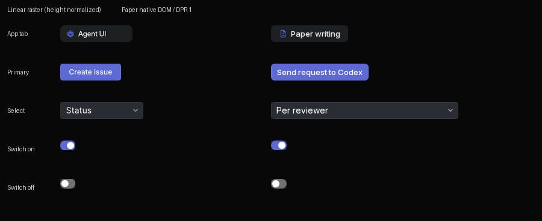
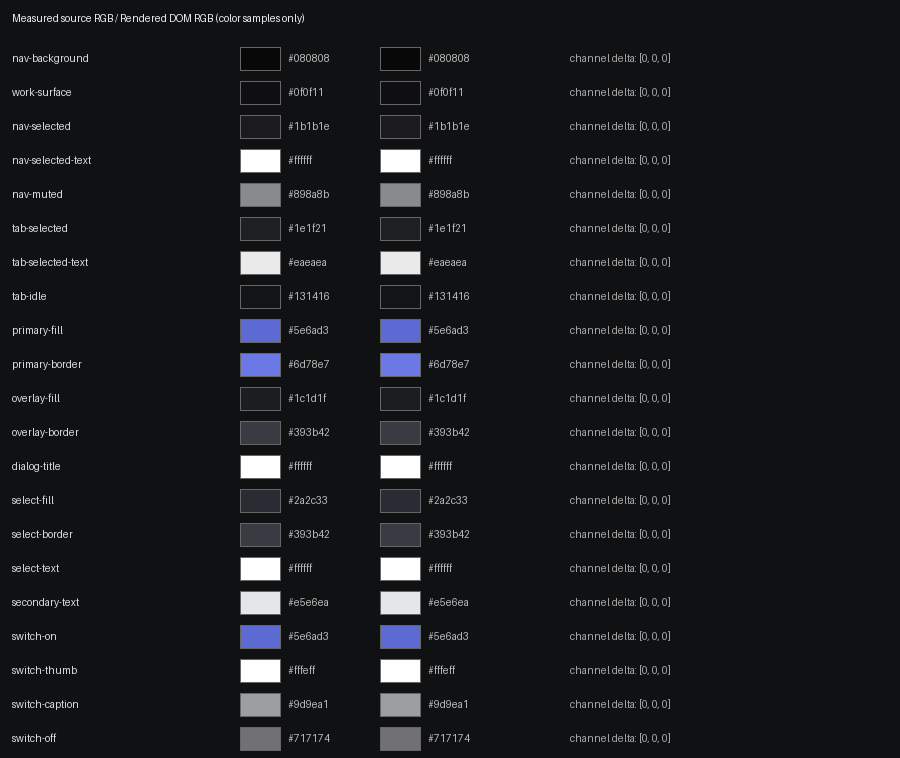
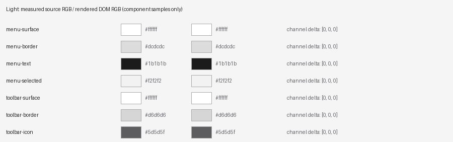
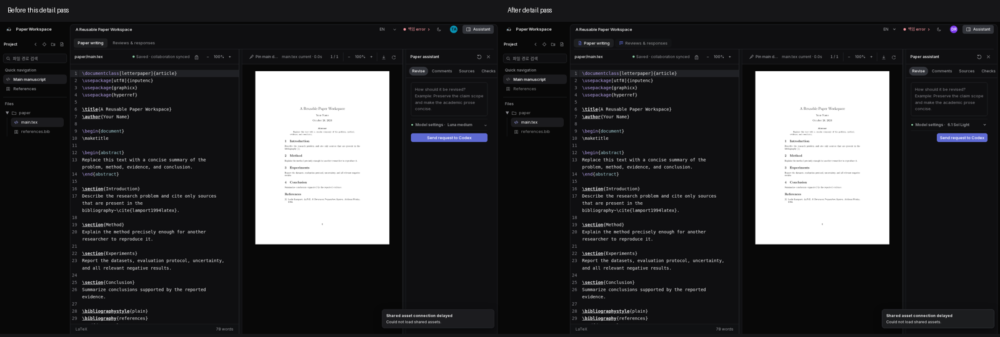

후속 화면 개편과 검증 범위는 [남은 화면 보고서](linear-remaining-2026-10-27.md)에 기록했다.

운영 배포와 이후 사용성 보완은 [2026-10-27 배포·검토 기록](deployment-usability-2026-10-27.md)에 기록했다.

# Linear 컴포넌트 정밀 보정 · 2026-10-26

제공된 앱 이미지에서 확인 가능한 색상·외형을 다시 대조하고 실제 DOM/CSS에 반영했다. 어두운 테마 21개, 밝은 테마 7개 역할·상태 색상 표본의 RGB가 원본 표본과 모두 일치한다. 이는 전체 디자인의 동일성 점수가 아니다.

## 기준 화면과 측정 범위

기준은 첨부 ZIP의 2026 계열 01 RIGHT 사이드바와 02 BOTTOM 앱 탭이다. 날짜가 확인되는 04/13/18/19는 속성·도우미·인박스의 보조 자료다. 05/07과 밝은 컴포넌트 10/11은 빌드가 확인되지 않아 해당 컴포넌트에 한정해 사용했다. 2024 자료 20은 제외했다. 공식 개편 글은 보조 근거이며, 인증된 Linear 앱 화면에 직접 접속했다고 주장하지 않는다. 원본 목록·해시·측정 좌표는 [레퍼런스 조사](linear-reference-2026.md)에 기록했다.

## 적용 규칙과 범위

- 공통 표면: 어두운 사이드바 #080808, 작업면 #0f0f11, 선택 행 #1b1b1e, 앱 탭 #1e1f21. 속성 패널 #1c1c1f와 팝업 #1c1d1f를 분리했다.
- 주 버튼: 배경 #5e6ad3, 경계 #6d78e7. 보조 컨트롤: 배경 #2a2c33, 경계 #393b42. hover·pressed에서도 글자 대비를 검증했다.
- 밝은 메뉴: 글자 #1b1b1b, 경계 #dcdcdc, 선택 행 #f2f2f2. 떠 있는 툴바는 경계 #d6d6d6와 아이콘 #5d5d5f를 별도로 사용한다.
- 데스크톱 컨트롤 높이 28px, 앱 탭 반경 7.5px, select 글자 14px, 공통 SVG 화살표 16px, 스위치 26×16px/손잡이 12px. 이 치수와 폰트는 배율을 정규화한 추정이며 Linear 공식 CSS 토큰이 아니다.
- 버튼의 중요도, 아이콘·quiet·위험·로딩·비활성 상태, 메뉴 선택·키보드 복귀, 입력·라디오·체크박스·스위치, 다이얼로그·툴팁, 네이티브 선택 메뉴를 공통 규칙으로 통합했다. 단순 다중 선택은 사각 체크박스를 유지한다.
- 로그인·프로젝트 허브·논문 작업공간·Rebuttal과 파일·도우미·댓글·작업·자료·검사·규칙·설정·백업 UI가 공통 테마와 프레임을 사용한다. 이번 추가 보정은 색상 역할, 탭 곡률, 화살표, 메뉴, 다이얼로그 제목, 스위치, 전송 버튼 폭·정렬과 상호작용 상태에 집중했다.
- reduced-motion에서 실제 전환 시간을 0으로 만들었다. forced-colors에서는 네이티브 select로 복귀한다. 아바타 색은 데이터 변경 없이 읽을 수 있는 전경색을 선택한다. 기존 Rebuttal 작성 흐름과 기능 변경은 보존했다.

## 실제 화면 비교

원본 왼쪽 / 구현 오른쪽. 높이를 정규화한 컴포넌트 비교이며 전체 페이지 픽셀 점수가 아니다.

이번 전후 이미지의 이전 화면도 이미 1차 개편이 적용된 상태다. 초기 개편 전후는 [이전 구현 보고서](linear-reference-implementation.md)에 보존했다. [현재 밝은 화면](design-refresh/precision/workspace-current-light.png), [현재 Rebuttal](design-refresh/precision/rebuttal-current-dark.png), [메뉴](design-refresh/precision/file-menu-dark.png), [다이얼로그](design-refresh/precision/delete-dialog-dark.png)도 별도 확인할 수 있다.

## 검증 결과

- 전체 Chromium 브라우저 테스트 **273개 통과**. 편집·선택·undo/redo, 공동편집·재접속, PDF·프로젝트 전환, Rebuttal·명시적 분석·규칙 적용, 테마·키보드·모바일 관련 검사를 포함한다.
- Python 플랫폼 테스트 **387개 통과**, Node 서버·백업 테스트 **41개 통과**. `git diff --check` 통과.
- Rebuttal은 320·390·1024·1600px, 양 테마, 한국어·영어·긴 문구의 96개 조합을 검사했다. 전체 문서 가로 넘침은 0건이다. 별도 프레임·컨트롤 테스트에서 정렬·크기·초점·선택 상태를 검사했다.
- 70개 아바타/커서 색상 조합의 대비가 4.5:1 이상이다. 실제 포인터 hover·pressed, loading, 툴팁, 메뉴 Escape, select 긴 문구, forced-colors와 reduced-motion을 검사했다.
- 캡처는 Chromium, DPR 1, 폰트 로딩 완료, reduced-motion 상태로 통제했다. 정상 PDF 파일을 실제 PDF.js 캔버스로 렌더링했다. 테스트 API 응답은 격리된 fixture를 사용하며 운영 데이터·권한·외부 LLM을 실행한 검증은 아니다.
- 재현: `PAPER_E2E_URL`로 실행 중인 로컬 서버를 지정한 뒤 `capture_linear_surfaces.mjs`, `capture_linear_review.mjs precision`, `measure_linear_precision.mjs`, `measure_linear_light.mjs`, `compare_linear_precision.py`를 실행한다. 스크립트는 저장소 `scripts/paper_platform`에 있다. 측정 JSON은 `design-refresh/precision`에 보존했다.

## 남아 있는 차이와 한계

Paper Workspace의 문구·로고·논문 데이터, 소스/PDF 분할, 기능별 작업 영역은 제품 고유의 차이다. PDF 본문은 원래 문서 표현을 유지한다. 원본의 뷰포트·DPR·확대율·폰트 빌드가 없으므로 동일 배율 전체 프레임의 1:1 판정은 할 수 없다. 같은 버전의 밝은 전체 앱 화면과 hover·disabled·loading 원본도 부족하다. 해당 부분은 공통 규칙과 접근성 기준으로 구현했으며 공식 측정값처럼 취급하지 않는다. WebKit·실제 스크린리더 전체 감사 및 운영 외부 서비스 종단 검증은 수행하지 않았다. 근거 없는 ‘100% 동일’ 판정은 하지 않는다.
