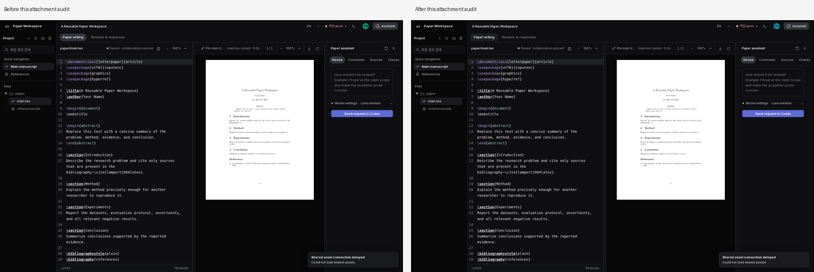
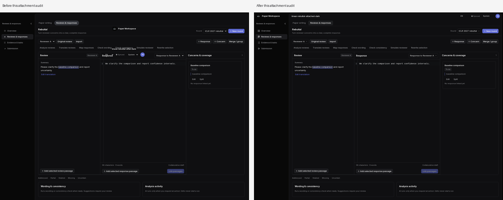
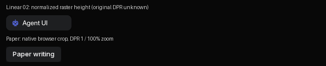

최신 세부 보정과 최종 검증은 [정밀 비교 보고서](linear-precision-2026-10-26.md)를 참고한다. 아래는 이전 단계의 기록이다.

# 첨부 Linear 앱 UI 기준 구현·검증 결과

2026-10-26. 기존 미커밋 개편을 보존하고 첨부 20장으로 기준을 다시 확인한 후 실제 구현을 보완했다. 이번 실행의 변경 전 화면은 이미 Linear 개편이 진행되어 있던 작업 트리다. 과거 전체 개편 전후 자료는 `linear-refresh.md`에 별도로 있으며, 그 문서의 누적 검사 수를 이번 실행 수로 합산하지 않는다.

## 기준과 측정

[첨부 감사·추출 규칙](linear-reference-2026.md)과 루트 `DESIGN.md`가 근거다. 주 기준은 [2026-03-12 공식 개편](https://linear.app/now/behind-the-latest-design-refresh)의 01 오른쪽 사이드바·02 아래쪽 앱 탭이다. 2026년 날짜가 있는 04/13/18/19는 같은 디자인 계열의 속성·보조 패널 근거로 사용하며 단일 앱 빌드라고 주장하지 않는다. [2024 문서](https://linear.app/now/how-we-redesigned-the-linear-ui)와 첨부20은 새 프레임·토큰 산출에서 제외했다. 날짜 미표기 메뉴·모달 등은 보조 구조 자료다. 개인 계정에 로그인한 화면을 확인했다고 주장하지 않는다.

- 원본 평탄 영역에서 확인: 어두운 탐색 `#080808`, 작업 표면 `#0f0f11`, 탐색 선택행 `#1b1b1e`, 앱 선택탭 `#1e1f21`, 속성 패널 `#1c1c1f`.
- 구현 추정: UI 13px, 행간18px, 아이콘16px, 기본 버튼28px, 레일224px, 위치 헤더48px, 앱 탭 행40px, 컨트롤 반경6px. 원본 CSS px·폰트 버전·DPR은 확인하지 못했다.
- 접근성 정책: 모바일/coarse pointer 컨트롤44px, 로그인48px, 키보드 focus2px, reduced-motion. 이는 Linear 공식 측정값이 아니다.
- 본문 대비 light14.89:1/dark15.35:1, 보조 light6.05:1/dark6.81:1, 어두운 overlay13.63:1, 선택탭15.01:1, primary4.70:1. 샘플 쌍의 계산이며 전체 WCAG 감사는 아니다.

## 구현 범위와 책임

공통 `theme.css`가 밝음/어두움 색상, 글꼴, 크기, 버튼·입력·체크박스·라디오·선택기·탭·모달·메뉴·토스트의 시각 상태를 소유한다. `project-frame.css`가 원고/Rebuttal의 프레임과 탐색 기하를 소유하고, 각 페이지 CSS는 제품별 배치를 맡는다. 새 프레임워크나 덧씌우기용 override 파일은 추가하지 않았다.

기존 개편을 포함한 적용 화면: 로그인, 허브, 파일 탐색·메뉴, 소스/PDF·resizer, 논문 도우미·Codex·댓글·작업·자료·검사, Rebuttal 네 화면, 규칙 작성·검토·적용, 프로필·테마, 백업·복원·내보내기. PDF 문서 본래 색상은 유지한다.

이번 실행의 구체적 보완:

1. 상단 앱 탭의 선택색을 로컬 선택 pill과 분리하고, 원본02의 작은 둥근 사각형으로 수정했다. 속성/overlay 표면을 원본04/18의 측정색으로 맞췄다.
2. Rebuttal CSS의 중복 프레임을 공통 파일로 옮겼다. 사이드바 문자 아이콘을16px stroke SVG mask로 통일했다.
3. 체크박스·라디오의 checked/indeterminate/focus/disabled와 닫힌 select 외형을 공통화했다. native 키보드·선택 의미와 forced-colors fallback을 보존했다. 열린 native select 목록은 OS/브라우저 표현 차이가 남는다.
4. primary의 실제 pointer active와 hover를 구분하고, 텍스트 실행 버튼의 aria-busy에 진행 표시를 추가했다. 기존 icon spinner는 중복 생성하지 않는다.
5. 파일 context menu의 Escape가 메뉴를 연 행으로 포커스를 돌려주도록 수정했다. 메뉴 화살표/Home/End 동작도 검증했다.
6. 320px 영어 Rebuttal 메뉴가 겹쳐 하단2×2 배치로 변경했다. 본문 끝의 공간을 함께 확보했다. 모바일 프로젝트 제목 입력은44px 타깃을 갖는다.
7. 로그인 독립 팔레트를 제거했다. 인증 전 HTML에 같은 `theme.css`와 배치 전용 `login.css`를 삽입하고 Docker에 두 파일을 포함했다. 보호된 폰트 파일을 요구하지 않도록 로그인은 시스템 글꼴을 쓴다.

API·저장 스키마·프로젝트 권한·Yjs 프로토콜·CodeMirror 상태·컴파일 로직을 디자인 목적으로 대체하지 않았다. 기존 사용자 변경을 되돌리지 않았다. 테스트 mock은 브라우저 fixture에만 있고 제품 동작을 더미로 바꾸지 않았다.

## 실제 전후·컴포넌트 비교

이번 before는 기존 작업 트리에 있던 실제 Chromium 캡처다. after도 실제 렌더이며 이미지 UI를 제품에 붙이지 않았다. 원고는1600×1000, DPR1, 글꼴 로딩 완료, 애니메이션 정지 상태다. Rebuttal은1600×1000 viewport의 전체 페이지 캡처다. 테스트 라운드 제목·작성자 등 다른 콘텐츠가 있어 전체 페이지 픽셀 차이를 디자인 점수로 사용하지 않는다.







탭 비교 위는 원본02의 `(812,1128)-(1536,1296)`을 Paper의28px 높이에 비례 축소한 것이다. 아래는 실제 DOM 선택탭 캡처다. 원본 DPR·줌 미상이므로 이것을 동일 배율 비교라고 부르지 않는다. 텍스트와 아이콘, 제품명 차이를 분리하여 확인했다. 평탄 바탕만 비교한 RGB 차이는0/0/0이다(`tab-color-diagnostic.json`). 이는 글꼴·반경·기하 일치 또는 유사도 백분율을 뜻하지 않는다.

추가 실제 화면: [밝은 원고](design-refresh/attached-reference/workspace-light-1600.png), [390px 원고](design-refresh/attached-reference/workspace-light-390.png), [규칙 대화상자](design-refresh/attached-reference/rules-dark.png), [320px 규칙 대화상자](design-refresh/attached-reference/rules-light-320.png), [파일 메뉴](design-refresh/attached-reference/file-menu-dark.png), [밝은 로그인](design-refresh/attached-reference/login-light-320.png), [어두운 로그인](design-refresh/attached-reference/login-dark-390.png).

## 이번 실행의 검증 근거

| 검사 | 결과와 범위 |
| --- | --- |
| 전체 Chromium 브라우저 회귀 |230개 실행: 최초222통과·8실패. 예전 정렬/활동문구/전환 기대값, 스냅샷, 모바일 입력 타깃을 수정하고 실패 대상 모두 재검증 통과. 새 컨트롤3개 별도 통과. 최종 수정 뒤 전체230개를 통째로 다시 실행한 것은 아니다. |
| 실패 대상 재검증 |프레임/전환13개, 활동/메타데이터4개, 원고 스냅샷/모바일2개 통과. 런타임 metadata 최초 실패는 재현되지 않았으며 해당1개 병렬3회 반복도 통과; 데이터 로직 변경 없음. |
| 공통 시각·상태 |실제 예제 PDF를 사용한 기존9개+새3개=12개 통과. 320/390/1024/1600 × light/dark, 긴 한/영 문구, 탭·메뉴·danger·프로필·테마·focus·disabled/loading. |
| Rebuttal 시각 조합 |네 화면×폭4×테마2×언어/긴문구3=96개, 가로 overflow0. 열린 규칙 대화상자와 선택 상태도 실제 이미지 확인. |
| 로그인 |계정·로그인47개 통과. 320/390×light/dark×ko/en8개 렌더에서 overflow없음, 입력·버튼48px, focus2px. |
| Python 플랫폼 |365개 실행: 최초345통과·20실패. 실패는 이전 CSS literal/스타일 파일 책임 기대값이며 해당 파일을 의미·선택자 중심으로 수정한 후69개 모두 통과. 제품 기능 assertions 유지. |
| Node 협업·백업 |41개 모두 통과: Yjs persistence/writeback, viewer 권한, 인증 경계, 백업 최신 응답·legacy 호환 포함. |
| 소스/자료 |ZIP20개 해시·해상도 일치, 변경 JS/Python 구문, git diff --check 통과. |

브라우저 회귀는 편집 선택·undo/redo·파일 전환, 두 브라우저 Yjs·복구, 컴파일 최신성·취소·고정 타깃, PDF/SyncTeX, 댓글·작업·Codex 대화, 백업/복원/ZIP, viewer, 리뷰 번역·다대다 매핑·분석 최신성, 규칙 초안의 명시적 적용, 명시적 분석 이외 LLM 호출 없음 등을 포함한다. 대부분 서버 fixture/모의 API를 사용했다. PDF 시각 검사는 기존 실제 LaTeX 컴파일 결과 `/tmp/paper-design-compile/main.pdf`를 사용했다. 이번 실행에서 LaTeX 엔진을 새로 컴파일한 것은 아니다. 운영 계정·LLM·외부 OpenReview 실호출·배포·WebKit·전체 화면리더 감사는 하지 않았다.

재현(서버가 없으면 Playwright config가 개발 fixture 서버를 띄운다):

```sh
cd apps/paper_workspace/collaboration
PAPER_VISUAL_PDF=/tmp/paper-design-compile/main.pdf npx playwright test tests/linear-refresh.spec.js tests/linear-reference-controls.spec.js --reporter=line
# 같은 개발 서버를 실행한 상태에서 저장소 루트에서:
node scripts/paper_platform/capture_linear_review.mjs
python3 scripts/paper_platform/compare_linear_reference.py
```

원본 ZIP은 `.omx/artifacts/linear-refresh/attached-reference/reference`에 보존했다. 원고/컴포넌트 JSON·PNG와 Rebuttal96조합 결과는 `.omx/artifacts/linear-refresh/`에 있다. 비교 스크립트는 위 폴더의 원본과 선택 탭 캡처를 필요로 한다. 실제 PDF가 없으면 `PAPER_VISUAL_PDF`를 생략해 오류/준비 상태 검사가 가능하다.

## 남은 차이와 정밀 재현에 필요한 자료

- 첨부는 확대·편집·암전이 있는 공식 제품 이미지다. 동일 viewport·zoom·DPR의 Linear 원본이 없어 **1:1 완료 판정은 유보**한다. 임의의 시각 점수나 “100% 동일”을 부여하지 않았다.
- 같은2026빌드의 밝음/어두움 전체 앱, 열린 프로젝트 선택기·속성 메뉴·확인 모달·댓글, 버튼 hover/focus/disabled/loading을 viewport·DPR·브라우저 줌과 함께 제공해야 정밀 판정할 수 있다. 자료가 없는 밝은 테마·상태·로그인은 공통 체계에 맞춘 추정이다.
- 논문/PDF 분할과 LaTeX 편집, 리뷰 근거 매핑, 제품 문구·로고·기능 배치는 Paper 고유 차이다. 모바일44px 타깃 및2×2 탐색도 제품 접근성 선택이다. Linear의 이슈 내용을 제품에 옮기지 않았다.
- 폰트 버전·한국어 OS fallback 및 열린 native select의 플랫폼 외형 차이가 남는다. 정적인 스크린샷만으로 관찰할 수 없는 상호작용은 기존 기능 계약과 접근성 규칙으로 구현했다.
