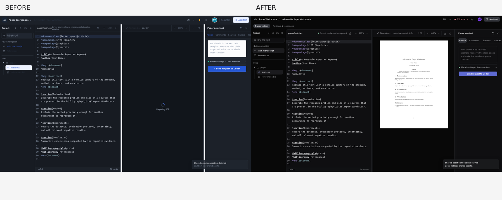
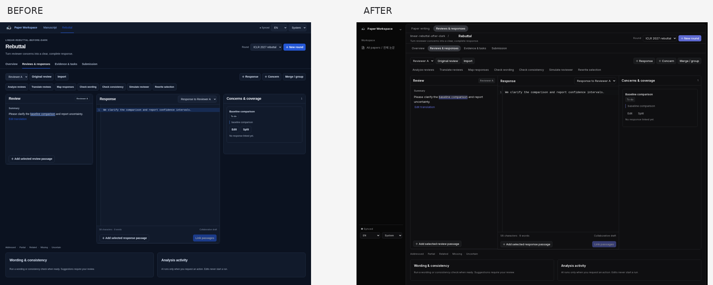
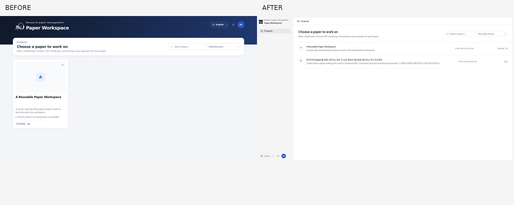

# Paper Workspace — Linear 앱 UI 기준 개편

> 첨부 20장 수신 이후 최신 구현·검증은 [첨부 기준 결과](linear-reference-implementation.md)를 참고한다. 아래의 “첨부 없음”과 누적 검증 수는 이전 작업 시점의 기록이다.

2026-10-26. 구현·회귀 검증 완료, **실제 앱과의 1:1 동일 판정은 보류**. 제공된 링크의 공개 제품 이미지는 확인했지만, 사용자 지정 스크린샷 첨부 및 동일 버전의 인증된 앱 화면은 제공되지 않았다. 원본 CSS 크기·뷰포트·배율을 확인할 수 없는 확대 편집 이미지를 동일 배율 스크린샷처럼 취급하지 않았다.

## 기준 화면과 추출 규칙

[Linear 2026-03-12 UI 개편 문서](https://linear.app/now/behind-the-latest-design-refresh)의 실제 제품 이미지가 기준이다. 사이드바 비교는 **오른쪽**, 경계선/탭 비교는 **왼쪽**이 새 UI다. [2024년 문서](https://linear.app/now/how-we-redesigned-the-linear-ui)는 시기 확인에만 사용했다.

원본과 좌표는 `.omx/artifacts/linear-refresh/` 및 `DESIGN.md`에 기록했다.

| 항목 | 확인 수준 | 적용 |
| --- | --- | --- |
| 어두운 내비게이션 | 원본 PNG 평탄 영역 샘플링 | #080808 |
| 작업 표면 / 선택 행 / 선택 pill | 원본 PNG 평탄 영역 샘플링 | #0f0f11 / #1b1b1e / #32343a |
| 작은 아이콘, 낮은 강조의 보조 동작, 둥근 선택 상태 | 이미지에서 관찰 | 아이콘 16px, 선 1.6px, 내비게이션 모서리 8px |
| 크기와 글꼴 | 이미지 비례를 토대로 정한 구현값 | 기본 rail 224px, 위치 헤더 48px, 버튼 28px, 13px UI / 18px 버튼 행간 |
| 터치·포커스 | 제품 접근성 기준 | 44px 터치 영역, 2px 포커스, reduced-motion |
| 밝은 테마·메뉴·로그인·모달·상호작용 상태 | 직접 대응 자료 부족; 추정 적용 | 공통 토큰과 기존 기능 상태를 일관되게 적용 |

정밀한 타이포그래피 검증을 위해 [공식 Inter 배포](https://github.com/rsms/inter)의 미수정 Variable 폰트를 로컬로 포함했다. 브라우저 CDP로 Latin UI의 `Inter Variable`, `isCustomFont: true`를 확인했다. Linear가 같은 폰트 버전을 사용한다는 주장은 아니다. 한국어는 시스템 한글 폰트, 인증 전 독립 로그인은 시스템 스택을 사용한다. OFL 라이선스 및 SHA-256은 보존했다.

## 구현 범위

- 로그인, 프로젝트 허브를 작은 브랜드 영역·앱 내비게이션·목록 중심 구조로 변경.
- 파일 탐색기, 소스/PDF 패널, 크기 조절 경계, 작업 툴바, 도우미의 수정·댓글·자료·검사·작업 화면 적용.
- Rebuttal 개요·리뷰와 답변·근거와 작업·제출 및 규칙 편집/검토/적용, 가져오기·내보내기 대화상자 적용.
- 프로필, 테마, 검색, 메뉴, 상태 창, 토스트, 백업·복원·내보내기, 로딩·빈 화면·오류·읽기 전용 상태 적용.
- 주요 실행은 indigo, 보조 작업은 중립/quiet, 삭제 메뉴와 확인창은 danger로 분리. 기본/hover/active/selected/focus/disabled/loading을 공통 규칙으로 연결.
- `theme.css`가 색상·글꼴·크기 토큰과 컨트롤을 소유한다. 기존 원고 CSS의 하드코딩 색상과 중복 컨트롤 장식을 정리하고, 화면 파일은 배치 및 제품 고유 상태를 담당한다. 추가 override 파일이나 프레임워크 전환은 없다.
- 동시 작업으로 추가된 ‘논문 작성 / 리뷰·답변’ 프로젝트 전환을 보존하여 통합했다. 원고 헤더는 위치 행 48px + 전환 행 40px = 88px, 모바일은 92px이며 파일 패널 시작점도 맞췄다.
- 기존 DOM ID와 이벤트, API·저장 형식·권한 경계를 유지했다. JS 변경은 Rebuttal 액션의 표현 클래스와 삭제 확인창의 danger 분류이다. 기존 사용자 Rebuttal/백업/편집기 변경은 보존했다.

## 전후 화면

이미지는 실제 Chromium 렌더링이다. 비교판은 읽기 편하도록 축소했으며 원본도 함께 보존했다. 테스트 데이터와 상태가 다르므로 전체 페이지 픽셀 차이를 유사도로 계산하지 않는다. 원고 before는 PDF 준비 중, after는 실제 예제 LaTeX을 컴파일한 PDF.js 출력이다. 개발 fixture의 백업/자산 API 미구현 안내가 보이는 화면도 그대로 기록했다.







[컴포넌트 선택 행 비교](design-refresh/selected-row-comparison.png)는 공개 이미지의 행 폭을 정규화한 보조 자료다. 텍스트·아이콘을 마스킹한 경계 차이 이미지도 보존했다. 참조의 원래 배율이 불명확하므로 픽셀 동일성이나 백분율 유사도 증거가 아니다.

## 검증

실행 위치: `apps/paper_workspace/collaboration`. Chromium, DPR 1, `document.fonts.ready`, reduced-motion 또는 screenshot animations disabled. 원고/대표 Rebuttal 1600×1000, 320·390·1024·1600px 반응형, 밝음/어두움, 한국어/영어 긴 제목·파일명·리뷰를 검사했다.

| 검증 | 결과 |
| --- | --- |
| 기존 원고/공통 브라우저 회귀 | 181개 통과로 정리; 최초 13개 실패 중 기존 색/크기 기대값은 새 계약으로 변경, 포커스·모바일 타깃·비활성 탭 회귀는 구현 수정 후 해당 검사 재통과 |
| Rebuttal 브라우저 회귀 | 최초 11/11; 동시 변경 통합 후 13개 모두 통과 (viewer 화면 이동 테스트 수정 후 해당 검사 재통과) |
| 허브 검색·정렬·번역·프로필·페이지 수·목록 배치 | 10/10 통과 |
| 새 공통 컨트롤·반응형 검사 | 9/9 통과 |
| 동시 작업의 프로젝트 전환·왕복 커서 복원 | 3/3 통과 |
| 로그인 서버 테스트 | 21/21 통과 |
| Rebuttal 화면/테마/언어/폭/긴 문구 배치 | 96 조합, 가로 넘침 0 |
| 실제 LaTeX | 예제 원고 pdflatex → BibTeX → pdflatex 2회 성공; PDF.js 렌더링 확인 |
| 글꼴 | CDP로 로컬 Inter Variable 실제 사용 확인 |
| 주요 색 대비 계산 | 본문 light 14.89:1 / dark 15.35:1, 보조 light 6.05:1 / dark 6.81:1, primary 4.70:1, danger 6.15:1 |
| 구문/공백 | 변경 JS 구문 및 git diff --check 통과 |

회귀에는 CodeMirror 선택/드래그/undo/redo/검색, Yjs 두 브라우저 동기화와 복구, 컴파일 취소/최신성/타깃 고정, PDF 확대·좌표·SyncTeX, 댓글·작업·Codex 대화, 백업·복원·ZIP, 읽기 전용, 규칙 초안의 명시적 적용, 다대다 매핑·번역·분석 최신성 및 **명시적 분석 동작 외 LLM 호출 없음**을 포함한다.

브라우저 API 테스트는 기존 fixture/모의 응답을 사용했다. 실제 운영 계정·운영 LLM·OpenReview 연결·운영 배포는 실행하지 않았다. 테스트용 모의 응답을 제품 구현에 넣지 않았다. 전체 화면리더 감사 및 Safari/WebKit 재검증은 수행하지 않았다. 동시 변경 통합 후 프레임·모바일·Rebuttal 관련 45개를 추가 검사했고, 답변 선택기가 없는 개요 화면으로 이동하던 viewer 테스트를 리뷰 화면으로 바로잡아 최종 45개 모두 통과로 정리했다.

재현:

```sh
# collaboration 디렉터리
node dev-server.mjs
# 별도 터미널: 예제 PDF가 있으면 경로를 지정하여 실제 PDF 화면도 캡처
PAPER_VISUAL_PDF=/tmp/paper-design-compile/main.pdf npx playwright test tests/linear-refresh.spec.js --reporter=line
npx playwright test tests/rebuttal.spec.js tests/hub-i18n.spec.js tests/hub-page-count.spec.js --reporter=line
```

일반 검사에는 `PAPER_VISUAL_PDF`가 없어도 되며, 그 경우 PDF 오류/준비 상태를 검사한다. 자세한 캡처 스크립트·PNG·JSON은 `.omx/artifacts/linear-refresh/`에 있다. `workspace-measurements.json`, `measured-controls.json`, `platform-fonts.json`, `contrast.json`, `rebuttal-after-layout.json`, `hub-visual-results.json`을 함께 확인한다.

## 남은 차이와 필요한 자료

1. **정확한 배율/치수**: 공식 이미지는 편집된 확대 이미지다. 동일 버전 앱의 실제 1× 캡처, 뷰포트 크기 및 브라우저 줌이 필요하다.
2. **밝은 테마, 메뉴·속성 팝오버·확인 모달·댓글**: 같은 2026 버전의 열린 상태 스크린샷이 필요하다. 현재 구현은 같은 체계로 확장한 추정이며 정밀 복제 판정을 하지 않았다.
3. **hover/focus/disabled/loading**: 정적 공개 자료에서 직접 확인되지 않아 접근성 및 기존 기능 상태를 기준으로 구현했다. 상태별 레퍼런스를 받으면 대응 영역 비교가 가능하다.
4. **제품 고유 화면**: LaTeX/PDF 분할, 논문 데이터와 리뷰 매핑은 기능 공간을 유지한 의도적인 차이다. 보조 텍스트는 읽기 쉬운 대비를 위해 이미지의 희미한 비활성 글자보다 밝다.
5. **폰트/플랫폼**: 같은 Linear 폰트 버전·렌더러는 확인하지 못했다. 한국어·로그인 시스템 폰트는 OS별 차이가 남는다.

따라서 현재 결과를 “100% 동일” 또는 “완벽한 복제”로 보고하지 않는다.

## 이번 점검에서 추가한 보완 (2026-10-26)

기존 미커밋 구현·검증 자료를 이어받아 원본 PNG와 실제 원고/Rebuttal 캡처를 직접 확인했다. 위의 누적 검사 수는 이번 실행에서 전부 다시 수행한 수가 아니다.

공통 프로젝트 전환 링크의 모바일 높이가 CSS 로딩 순서 때문에 28px로 돌아가고, Rebuttal 탭·선택기·우려 사항 동작이 24–36px로 남아 있던 부분을 수정했다. 높이는 `theme.css`의 `--control-height` 한 곳에서 결정하며, 페이지 스타일은 이를 소비한다. 문서에 남은 밑줄 선택 상태 설명도 실제 공통 pill 계약으로 바로잡았다.

이번 확인: 프로젝트 전환/Rebuttal 기존 16개 통과, 수정 뒤 공통 컨트롤·반응형·모바일 보완 11개 통과. 추가 모바일 검사는 320·390px × 한국어·영어에서 프로젝트 전환, 화면 탭, 내비게이션, 라운드/답변 선택기, 분석 버튼, 우려 사항 제목의 실제 44px 높이와 가로 넘침 없음을 확인했다. 원고 320·390·1024·1600px 양 테마와 긴 문구, hover/focus/disabled/loading, 메뉴·삭제 확인·프로필·테마 창도 포함한다. 변경은 CSS와 검증/설명에 한정하며 API·데이터·편집 동작은 변경하지 않았다.

동일 배율의 Linear 원본이 없으므로 1:1 승인이나 임의의 시각 유사도 점수는 부여하지 않았다. 후속 정밀 비교에는 **2026 개편 후 실제 앱의 밝음/어두움 전체 화면, 열린 프로젝트 선택기·속성 메뉴·댓글·확인 모달, 상태별 버튼 캡처**와 각 캡처의 뷰포트·줌·DPR이 필요하다.

터치 태블릿 검토에서 1024px coarse pointer의 44px 링크와 기존 40px 고정 헤더 행 사이 불일치도 수정했다. 원고 헤더 행·하단 여백·전체 높이가 같은 계산값을 사용한다. 프로젝트 전환 기존 3개가 통과했고, 실제 hasTouch 신규 검사는 최초 0.5px 넘침을 발견한 뒤 수정·대상 재검사하여 통과했다. 구분선은 inset shadow로 표현하여 44px 행 내부 공간을 줄이지 않는다. 실제 예제 PDF를 사용해 공통 시각 검사 9개도 통과하고 원고 캡처를 갱신했다. [수정 후 320px 한국어 Rebuttal](design-refresh/rebuttal-touch-ko-320.png)에서 확대된 동작 영역과 줄바꿈을 직접 확인했다.
