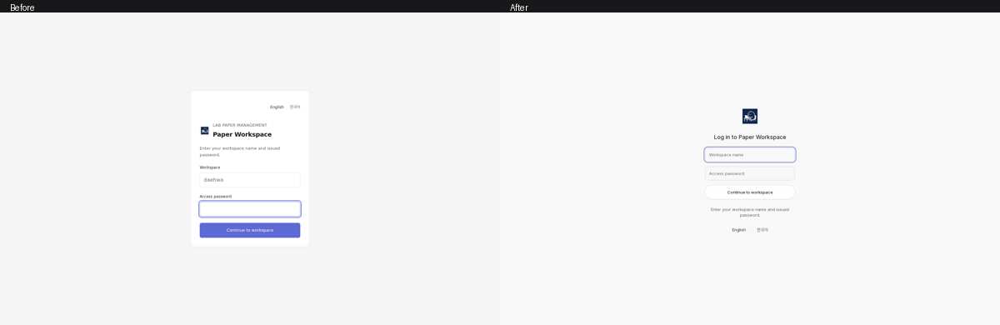
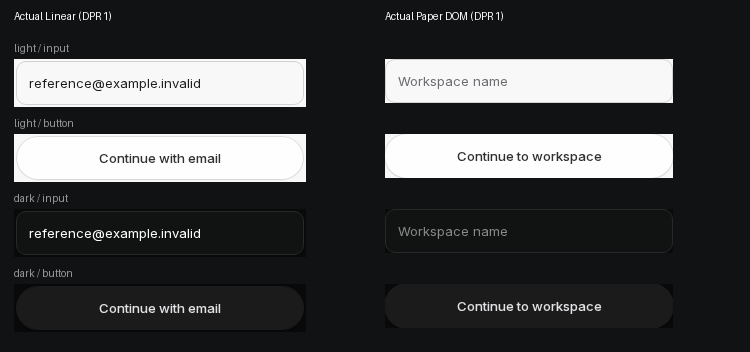
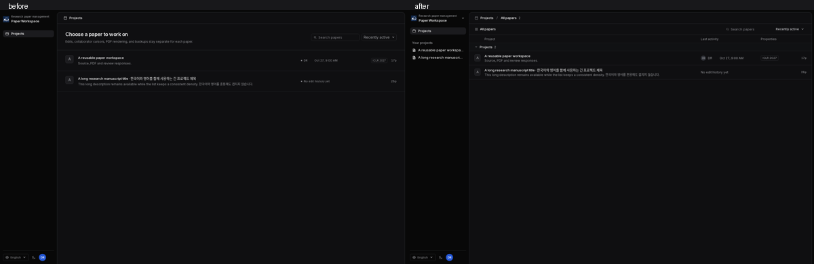
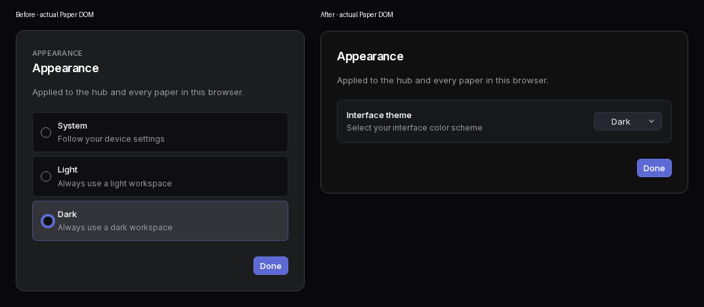
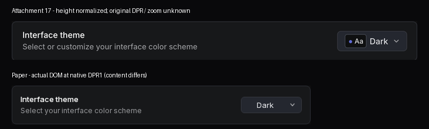

# 남은 화면 개편·검증·배포 · 2026-10-27

로그인·허브·프로필/테마·프로젝트/속성 메뉴와 남은 입력·검색·백업·모델 컨트롤을 실제 DOM/CSS로 보완하고 운영에 반영했다. 공통 규칙 적용과 실제 Linear 화면을 직접 대조한 범위를 구분한다. 전체 화면이 100% 동일하다고 판정한 보고서는 아니다.

## 1. 기준 화면

- 앱 안의 우선 기준은 첨부 ZIP의2026 사이드바01/앱 탭02와 지정 컴포넌트 이미지다. 최초 [레퍼런스 조사](linear-reference-2026.md)의 우선순위를 유지했다.
- 추가로 [실제 Linear 로그인](https://linear.app/login)의 최초 화면·이메일 단계·hover/blur/focus를 양 테마로 직접 렌더링했다. 인증하거나 폼을 전송하지 않았다.1600×1000·390×844, DPR1, zoom1, 폰트 로딩 완료 상태의 CSS/DOM과 실제 custom Inter 렌더를 확인했다. [공개 화면 감사](design-refresh/remaining/reference-audit.md).
- 공개 데모의 실제 이슈 목록·프로젝트 타임라인·팀 메뉴·속성 팝오버도 확인했다. 인증된 설정 경로는 열리지 않았다. 현재 공개 앱과 첨부가 같은 빌드인지는 확인하지 못했으며, 현재 앱의 pill 버튼/다른 팔레트를 첨부 기준 앱 전체에 덮어쓰지 않았다.
- 설정행은 첨부17 Preferences의 레이블·설명·우측 컨트롤·행 구분선과 측정한 표면을 사용했다. [공식 Profile](https://linear.app/docs/profile)의2개 제품 이미지와 [Workspaces](https://linear.app/docs/workspaces)의 전환기 이미지도 추가 확인했다. 시기·배율이 없는 문서 crop이며 설정행/메뉴 규칙의 보조 근거로만 사용했다. 인증 전용, 앱 공통, 제품 고유 구성의 역할을 `DESIGN.md`에 기록했다.

## 2. 주요 규칙과 구현 범위

| 영역 | 구현한 규칙과 실제 동작 |
|---|---|
| 로그인 | 테두리 카드 제거,288px 평면 구성,48px Paper 로고,18px/500 제목,24/32px 간격,44px 입력/버튼,10px 입력 모서리·pill CTA. 실제 배경·글자·입력·기본/hover 버튼 색 적용. |
| 로그인 글꼴·인증 | 같은 Inter 번들을 인증 전 정확한 한 경로로 제공. 기존 계정명/암호·POST·쿠키·접근 권한·오류/제한 안내 유지. 사용자명부터 키보드 진입. 가짜 외부 로그인 기능 없음. |
| 허브·프레임 |244px 기본 레일, 저장된 수동 폭 보존. 큰 소개 영역 대신 위치 헤더·로컬 툴바·열 제목·접기 그룹·프로젝트 바로가기·실제 활동/속성. 검색/정렬·썸네일·프로젝트 진입 유지. |
| 프로필·테마 | 설정 그룹·행·경계선·레이블 계층 통합. 테마는 참조처럼 한 행의 실제 드롭다운. 이름·색, 즉시 적용, 저장·취소·시스템 테마와 언어·포커스 유지. |
| 프로젝트·속성 메뉴 | 인증된 카탈로그 검색과 프로젝트 이동. 실제 select 값을 변경하는 메뉴·키보드·검색·선택·비활성·Escape/외부 클릭. 모달 내부 portal, 강제색상 native 복귀, 재렌더 후 정리. |
| 파일·백업·검색 | 파일 선택 버튼도 공통 외형. 입력33/34px·검색36px 잔존 규칙을28/44px로 정리. 백업 비교/복원은 중립 utility 그룹, 위험 작업은 기존 확인 절차 유지. |
| 도우미·댓글·작업·검사·자료 | 공통 버튼/입력/목록과 상태. 원고 맥락을 표시하는 하단 composer·모델 팝오버·행 hover/selected/focus. 댓글 아바타·활동·키보드 해결·번역. 편집/설정 조작만으로 LLM 호출 없음. |
| 소스·PDF·Rebuttal | source/PDF/댓글 강조를 공통 accent로. 실제 문서·편집기·공동편집·SyncTeX·버전·리뷰/규칙/매핑의 기능 경계 유지. 제품 고유 작업 영역은 공통 프레임·툴바·속성 규칙을 사용한다. |

## 3. 실제 전후·대응 컴포넌트

로그인의 비교 가능한 치수·폰트·색상62개 값이 원본과 일치한다. [비교 JSON](design-refresh/remaining/login-measurements.json), [실제 렌더 측정](design-refresh/remaining/login-rendered.json). 이는 여러 역할·양 테마의 비교값이며 전체 디자인 유사도 점수가 아니다. 제품명·로고·문구와 입력 필드 수는 같게 만든 비교 대상이 아니다.

전후 이미지는 이번 추가 보정 이전/이후다. 이전 화면도 이미1차 개편이 적용된 상태이며, 초기 전면 개편 전후는 [이전 보고서](linear-reference-implementation.md)에 보존했다. [실제 운영 밝은 로그인](design-refresh/remaining/production-login-light.png)과 [어두운 로그인](design-refresh/remaining/production-login-dark.png)도 별도 확인할 수 있다.

## 4. 기능·시각 검증

- 병행 변경을 보존하면서 검증용 소스/테스트 복사본을 고정했다. [전체 브라우저312개 통과](design-refresh/remaining/browser-312.log), [Python387개 통과](design-refresh/remaining/python-387.log), [Node 서버/백업41개 통과](design-refresh/remaining/node-41.log).
- 이후 단일행 테마 선택기·댓글 키보드·번역·로그인 제목 박스 보정을 반영하고 [영향 검사33개](design-refresh/remaining/final-patch-33.log), [최종 UI/로그인 Python91개](design-refresh/remaining/final-ui-python-91.log)가 통과했다.312개를 이 최종 보정 후 다시 실행한 것으로 합산하지 않는다.
- 로그인은 공유/계정 모드·두 언어·양 테마·320/390/1024/1600px의32조합, 허브16조합, 설정32조합/64 dialog/32 열린 메뉴, 도우미/검색/백업/작업16조합을 실제 렌더링했다. 보고한 검사에서 가로 넘침·페이지 오류·의도하지 않은 LLM 요청은0건이다. [설정 측정](design-refresh/remaining/settings-summary.json), [컨트롤 측정](design-refresh/remaining/controls-summary.json).
- Rebuttal의 개요·리뷰/답변·근거/작업·제출, 양 테마, 한/영·긴 문구, 네 폭의 [96조합](design-refresh/remaining/rebuttal-96.log)도 가로 넘침0건이었다. 실제 PDF를 PDF.js 캔버스로 표시해 원래 흰 문서 픽셀과 포커스·강조를 확인했다.
- 키보드 메뉴/모달·실제 파일 선택·radio/checkbox/switch·포커스 복귀·readonly/disabled/busy·forced-colors·reduced-motion을 검사했다. 모달 밖 팝업의 클릭 불가, 잘못된 ArrowUp 이동, native 접근성 복귀와 관찰자 정리 문제를 재현/수정했다. [메뉴 계약 보고](design-refresh/remaining/property-picker-report.md).
- 전체 테스트는 격리된 API fixture를 사용한다. 운영에서는 실제 계정 로그인·권한 차단·실제 PDF·데이터가 있는 리뷰·설정·프로젝트/도우미 메뉴·로그아웃을 추가 확인했다.15개 확인 항목과32개 화면 조합 통과, JS 오류/LLM 호출0건. [운영 검사 JSON](design-refresh/remaining/production-evidence.json).
- Caddy 구성 검증, JavaScript 구문과 `git diff --check` 통과. 검증본과 운영 프런트엔드/로그인의 [핵심 정적 파일10개 SHA-256 일치](design-refresh/remaining/deployed-asset-comparison.json)를 확인했다.

## 5. 운영 반영과 보존

검증/배포 후보는 `20261027-084415-linear-remaining`이다. 이 작업이 작업공간·로그인·Caddy를 교체한 뒤 병행 작업이 같은 프런트엔드·로그인 코드를 `20261027-085530-linear-components` 이미지로 배포했다. 해당 검증 시점의 운영 파일이 검증한 코드와 동일함을 해시로 다시 확인했다. 이후 병행 작업의 로고·Rebuttal 미리보기·설명 정리 및 Codex bridge 후속 배포가 진행되어, 현재 운영 전체를 이 동결본과 동일하다고 주장하지 않는다.

이 작업의 배포·검증 시점에는10개 서비스가 모두 healthy였고 모든 기존 볼륨의 경로·쓰기 속성을 보존했다. 이 배포에서는 협업·컴파일·백업·Rebuttal·Codex 등7개 백엔드 이미지를 교체하지 않았다. 이후 별도 배포의 변경은 해당 작업의 검증 범위다. 백업 DB와 리뷰 DB의 최신 온라인 체크포인트를 별도 파일로 보존하고 무결성을 확인했으며, 이전 이미지·설정·롤백 스크립트를 유지했다. 운영 원문 편집·리뷰 가져오기 확정·규칙 적용·백업 복원·외부 LLM 호출은 이 검증에서 실행하지 않았다.

실제 논문/리뷰 전체 캡처와 인증 정보는 비공개 릴리스 기록에만 보존한다. 공개 보고에는 로그인과 격리된 예제 화면·컴포넌트만 사용했다. 동결본 이후의 사용자 파일 변경을 reset하거나 지우지 않았다.

## 6. 남아 있는 차이와 자료 범위

- 계정명+발급 암호, Paper 로고·논문·리뷰, 소스/PDF 분할, 프로젝트 정보2줄/56px, 로컬 프로필 색상 등은 실제 Paper 기능에 따른 차이다. Linear의 Google/SSO/계정·이메일 변경/사용자 업로드 같은 다른 기능을 모양만 추가하지 않았다.
- placeholder는 읽을 수 있는 대비로 보정했고 키보드 포커스는2px를 유지했다. 실제 Linear 로그인에서 관찰한 더 옅은 placeholder/1px outline과 이 부분은 다르다. 한글 fallback과 실제 모바일 기기/Safari/스크린리더 전체 감사는 별도 확인 범위다.
- 첨부17의 색/설정행은 관찰했지만, 인증된 Linear 프로필·설정 전체 화면과 같은 빌드의 모든 열린 메뉴·disabled/loading 상태를 직접 확인한 것은 아니다. 설정의 맞춤 테마 미리보기 장식도 Paper의 고정 세 프리셋과 구분했다. 그 범위를1:1 검증 완료라고 주장하지 않는다.
- 현재 공개 앱의 빌드와 첨부 이미지의 버전 일치가 입증되지 않았다. 이 한계는 임의 점수나 전체 페이지 픽셀 차이로 대신하지 않는다. 남은 엄밀한 직접 대조에는 같은 버전의 프로필·설정 및 열린 워크스페이스 전환기 원본과 viewport/DPR/zoom 정보가 필요하다.

검증 시점: 2026-10-27T09:00:44.826776+09:00 (KST). [후속 배포 이후 현재 공개 로그인](design-refresh/remaining/current-login-light.png)도 별도 재확인했으며 폭288px/입력·버튼44px/두 테마·가로 넘침0건을 확인했다. [해당 측정](design-refresh/remaining/current-login-metrics.json). 후속 로고가 포함된 이미지이며, 이후 추가된 리뷰 미리보기나 bridge 기능을312개 검사에 포함했다고 계산하지 않는다.
